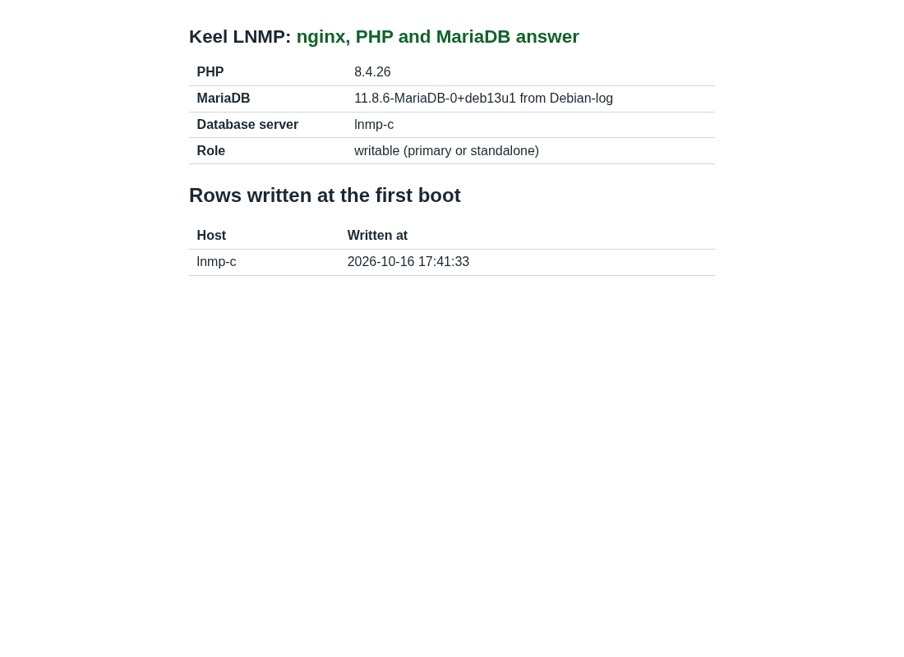
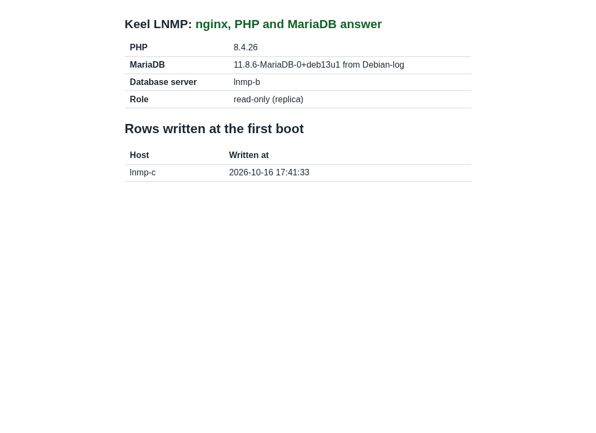
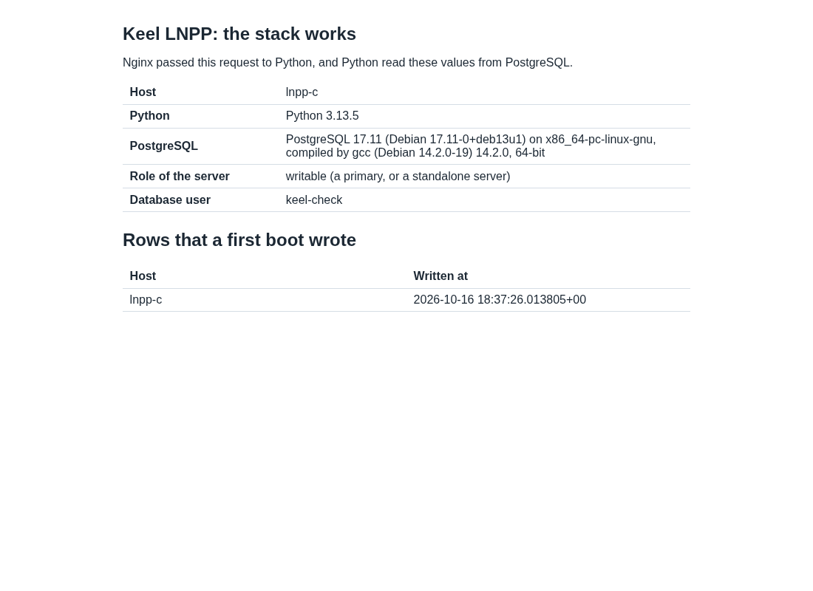
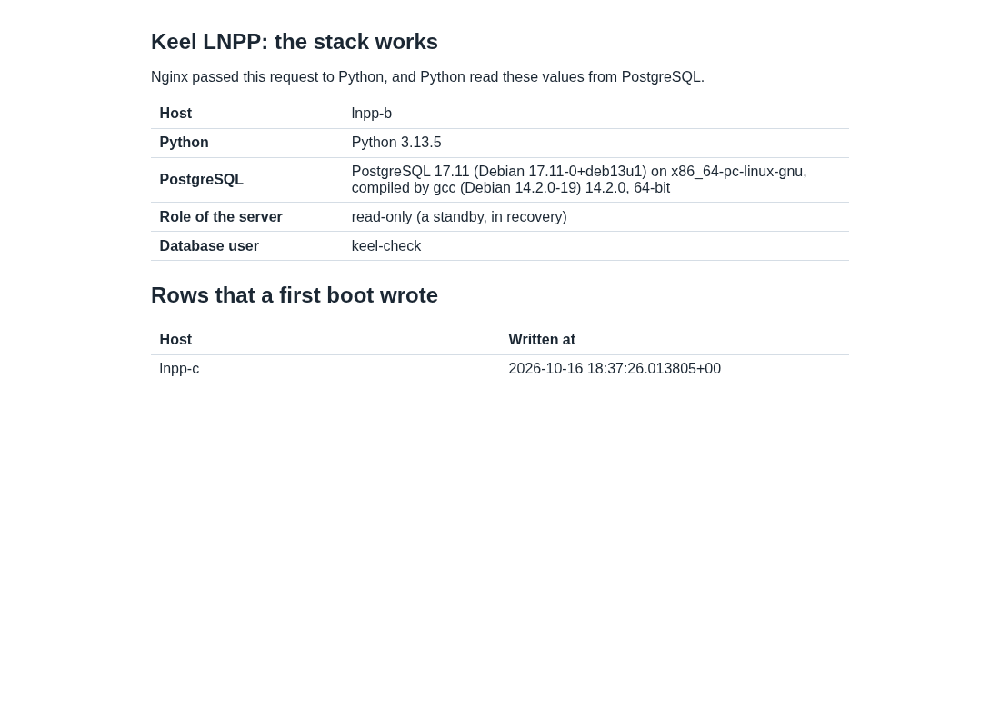

# Evidence: LNMP 19.0-3 and LNPP 19.0-4, a release test across 2 sites

Date: 2026-10-16. The time zone is UTC.
Decisions: 0049, 0054, 0057, 0059, and the amendments of 0031 and 0049
of 2026-10-16 (handbook#98).
Rule of the maintainer, 2026-10-16: a release test uses 3 CTs, 2 on
BR1 and 1 on BR2, with the database pair across the 2 sites.

No secret is in this file. Output is trimmed.

## Result

| Image | sha512 (first 16) | keel | Result |
| --- | --- | --- | --- |
| `debian-13-keel-lnmp_19.0-3_amd64.tar.zst` | `001edadb7cba6de3` | 0.23.41 | PASS, every item (run 2) |
| `debian-13-keel-lnpp_19.0-4_amd64.tar.zst` | `4cbc01d5d2b1ffeb` | 0.23.41 | PASS, every item (run 3) |

LNPP is 19.0-4, not 19.0-3. Its run on 19.0-3 found keel#201 in the
image, and the gate "package / changelog" of keel-lnpp needs a new
version for a change that ships. No 19.0-3 image is published for
LNPP. Two builds of LNMP 19.0-3 were made: the first one (keel 0.23.39)
failed the run and is not published. See "The runs".

Each topology has 3 CTs: 2 on BR1 (hw12-br1) and 1 on BR2 (nfs1-br2).
The database pair crosses the sites: the first primary is on BR2, the
synchronous standby on BR1. The witness on BR1 is the third etcd
member and the root's holder of the mesh.

| | BR1, witness | BR1, pair node | BR2, pair node |
| --- | --- | --- | --- |
| LNMP | 9111 `lnmp-w` | 9112 `lnmp-b`, replica at installation | 9113 `lnmp-c`, primary at installation |
| LNPP | 9121 `lnpp-w` | 9122 `lnpp-b`, replica at installation | 9123 `lnpp-c`, primary at installation |

With 2 voters on BR1, a cut of the whole BR1 site leaves 1 of 3
voters, so no failover is possible then. Decision 0051 asks for 3
regions; BR3-THIN, the third site, is offline. So the test cuts the
CT of the primary, never the whole BR1 site. The BR2 CT is the only CT
of BR2, so a cut of it is a cut of the BR2 site.

## Pass criteria, written before the run

Each item passes only with the keel CLI and no operator step on the
product. The test changes only these: the network of a CT (an nft
table, `tc netem`), the power of a CT (`pct stop`, `pct start`), the
test tools under `/root/logs`, and a test database with its writer
account. The confirmed reseed (`keel spec apply --system-only
--destroy-local-database`) is the product path of case (d), and it
counts as a keel CLI step. Each item runs for LNMP and for LNPP.

| Item | Passes when |
| --- | --- |
| First boot | each of the 3 CTs completes the first boot headless from its spec; `systemd-modules-load` is the only failed unit |
| Mesh and etcd | `keel mesh create`, `invite`, `join` and `keel mesh etcd form` give 3 healthy voters, 2 on BR1 and 1 on BR2 |
| Pair | the standby streams or replicates from the primary over TLS, synchronous; the Anubis key reaches the standby with no operator step (common#56) |
| Check page | `/keel-check/` answers 200 over HTTPS at the VIP, through Anubis, and shows the row of the primary on both nodes |
| Writes replicate | a row written at the VIP is on the standby |
| Failover 1, network cut | the primary's CT loses its WireGuard traffic; the VIP moves by itself; the first write is acknowledged at most 5 s after the VIP lands on the new primary; 0 acknowledged ids lost |
| Old primary returns | after the heal it takes no write and does not serve as a primary; it is fenced, and keel records why |
| Reseed | the confirmed reseed makes it a synchronous standby again |
| Failover 2, `pct stop` | the same bounds, in the other direction; after `pct start` the old primary is fenced and takes 0 writes |
| netem | failover 1, the return, the reseed and failover 2 again, with 250 ms ±25 ms and 1 to 2 % loss between BR1 and BR2 |
| Firewall | each CT accepts only the expected ports on its uplink; the database port answers on `wg0` only |
| End | `keel diff` reports no drift on the 3 CTs; netem and the test nft table removed |
| Screenshots | the check page of both pair nodes, through Anubis |

If an item fails, the issue is opened or updated, the fix is made, the
image is built again, and the whole matrix runs again on the new image.

## What changed before the run

The 19.0-2 images passed on BR1 only. Three issues were open
(keel#183, common#56, keel#106). Three rehearsals on BR1 and BR2, on
the 19.0-2 images, found 5 more defects before 19.0-3 was built. The
runs found 3 more (keel#199 with keel#140, keel#201). Each
defect has its issue and its fix, with tests first.

Every keel PR merged with all 12 checks green, merge commits only.
keel has no `appliance` gate. The `appliance` gate of keel-lnmp and
keel-lnpp ran and stopped at "Ask the mirror for the layer": no lnmp
or lnpp layer is on the mirror, so it booted nothing. The boot proof of
these images is this file.

| PR | keel | Issue | What |
| --- | --- | --- | --- |
| keel#185 | 0.23.33 | keel#183 | The reseed probe measures only the databases that `repl` may connect to |
| keel#187 | 0.23.34 | common#56 | A paired replica asks the other member for Anubis's key |
| keel#189 | 0.23.35 | keel#106 | The VIP overlay waits for etcd's cluster with no drift |
| keel#190 | 0.23.36 | keel#186, keel#193 | The fence of an old MariaDB primary ends its connections, and the dump threads of its replicas; semi-synchronous timeout 30 s |
| keel#191 | 0.23.37 | keel#188 | An apply that starts etcd records it; the start enables wireguard |
| keel#194 | 0.23.38 | keel#192 | The VIP fence of a caught-up MariaDB replica is cleared |
| keel#197 | 0.23.39 | keel#195 | A MariaDB holder whose lease is in doubt acknowledges no write |
| keel#196 | none | keel#167 | Test only: the rejoin bound of the etcd netns test leaves room for loss |
| keel#200 | 0.23.40 | keel#199, keel#177 | keel mesh etcd form sends the cluster again to a member that never ran; a failed connection frees its slot before it closes |
| keel#144 | 0.23.41 | keel#140 | Every overlay peer gets PersistentKeepalive = 25 |
| keel-lnpp#3 | | keel#183 | The check database revokes CONNECT from PUBLIC again |
| keel-lnpp#4 | | keel#201 | A preset disables postgresql-common's WAL archival (LNPP 19.0-4) |
| keel-lnmp#4 | | | Changelog 19.0 (3) |
| apt#41, apt#43 | | | The publish commits of keel 0.23.39 and 0.23.41 |
| handbook#98 | | | Amendments of 0031 (MariaDB timeout 30 s) and 0049 (the doubt of the lease) |

### The rehearsals

Each rehearsal used new CTs: 2 on BR1 and 1 on BR2, removed at the
end. Rehearsals 2 and 3 installed the keel of the open pull requests
by hand. That hand step is for a rehearsal only. The release test
installs nothing by hand.

| Rehearsal | Image, keel | Result | Issues |
| --- | --- | --- | --- |
| 1 | lnmp 19.0-2, keel 0.23.29 | VIP moves by itself; 12 of 1906 acknowledged ids lost; the second failover does not move the VIP; mariadbd hangs after the old holder connects again | keel#186, #188, #192, #193 |
| 2 | lnmp 19.0-2, keel 0.23.38 | 0 lost, by 1.7 s of luck: a waiting write returned OK when the dump thread to the cut replica ended | keel#195 |
| LNPP | lnpp 19.0-2, keel 0.23.38 | every item passed | none |
| 3 | lnmp 19.0-2, keel 0.23.39 | every item passed; cut to read only 8.8 s (5 ms) and 6.1 s (250 ms); 0 of 6908 and 0 of 13337 lost; no false doubt in 2 quiet windows of 10 min | none |

## keel in trixie-testing

The build host built keel from `main` and published it to trixie-testing
only, signed by the main key and the testing key with nobody at a
keyboard (decision 0055). trixie (stable) is not changed.

```
# build host, /srv/keel-apt/apt
$ bin/build-package --native keel main </dev/null
build-package: done: keel_0.23.39_amd64.changes in /srv/keel-apt/incoming
sha256 48166ca9cce1b8b8cc8250558bf4d764188be37fb948c2ed93696d82661de0e4  keel_0.23.39_all.deb
$ bin/build-package --native keel main </dev/null          # after keel#200, keel#144
sha256 23f50272e58ab1d50397d7ea9e26320391f8e6e358fa6684eabdd90f10758a38  keel_0.23.41_all.deb
$ bin/publish </dev/null
publish: committed in /srv/keel-apt/apt: publish trixie-testing: keel 0.23.41
# workstation
$ keel-publish-mirror --archive-only
keel-publish-mirror: https://archive.keellinux.org trixie verifies
keel-publish-mirror: https://archive.keellinux.org trixie-testing verifies
keel-publish-mirror: https://archive.keellinux.org trixie-security verifies
$ curl -s https://archive.keellinux.org/dists/trixie/main/binary-amd64/Packages | grep -A1 '^Package: keel$'
Version: 0.23.21
$ curl -s https://archive.keellinux.org/dists/trixie-testing/main/binary-amd64/Packages | grep -A1 '^Package: keel$'
Version: 0.23.41
```

## Build and signatures

keel-release on the build host, release directory
`/srv/keel-release/2026-10-16`, on Core 19.0-10 and Web 19.0-6
(keel-web 0.3.0). The layers come from Debian 13 and
archive.keellinux.org trixie-testing.

- A layer whose tarball matches its manifest is not built again, also
  when a package of it changed. So the first build of 19.0-3 ran with
  `--rebuild`, and the layer of LNPP 19.0-4 with `--match-source`
  (only the layer whose source changed).
- The first 19.0-3 build carried keel 0.23.39. It is kept aside in
  `/srv/keel-release/withdrawn-2026-10-16-19.0-3-keel-0.23.39` and is
  not published.

What each published image carries, read from its `var/lib/dpkg/status`:

| Image | Source | keel | Other |
| --- | --- | --- | --- |
| lnmp 19.0-3 | keel-lnmp c1d07cc | 0.23.41 | |
| lnpp 19.0-4 | keel-lnpp 74fd1df | 0.23.41 | `20-keel-lnpp.preset`; `REVOKE ALL ON DATABASE keel_check FROM PUBLIC` in `40lnpp-check` |

On the workstation, with the public keyrings of apt `keys/`:

```
sha512sum -c debian-13-keel-lnmp_19.0-3_amd64.tar.zst.sha512   OK
sha512sum -c debian-13-keel-lnpp_19.0-4_amd64.tar.zst.sha512   OK
sqv --keyring keel-archive-keyring.asc   (lnmp, lnpp)   AD0964BE3F09DED469A3B6B2148E951314703180
sqv --keyring keel-images-keyring.asc    (lnmp, lnpp)   E71DB9C3CA6AC18075395CC3ED3A709C4F3E2F3C
sqv with a changed .sha512                              Message has been manipulated
```

Full digests:

```
001edadb7cba6de3f8f113ef63dac19d3e0bcfeb650d6e73bea79534b8d6ee1d3ffdfc53bd1f1d21e1e1beb6628ecf5f5e2247c9a3096812fa05d62a796e258d  debian-13-keel-lnmp_19.0-3_amd64.tar.zst
4cbc01d5d2b1ffeb4bb8372b68b1bd668edc3538590732a5e6dcd3f19dab6a2e45cc37abad89b0ac39a7702bde1de79b87849062ac4584c0cbf0536f6b5cddb7  debian-13-keel-lnpp_19.0-4_amd64.tar.zst
```

Sizes: lnmp 253,372,903 bytes, lnpp 282,814,764 bytes. The templates
were copied to `/var/lib/vz/template/cache` of BR1 and BR2, and
`sha512sum -c` passed on each host.

## The method

The same for each run and each image:

1. Boot the witness W and the BR2 node C from the template with the
   harness of BR1 (`/root/lx/br1-ct2.sh`) or BR2 (`/root/lx/br2-ct.sh`).
   Each writes the spec and random secret files into the CT and starts
   it, with `--searchdomain keel.test`. The first boot specs declare
   `installation.mode: cloud_advanced`, `firewall.enabled: true`, and
   the overlays `wireguard` and `etcd` enabled.
2. On W, run `keel mesh create`, then `keel mesh invite` for C and for
   B. On C, run `keel mesh join`.
3. Boot B with `database.server.role: replica` and
   `replication.primary.host` set to the address the invite reserved
   for C. On B, run `keel mesh join`. etcd forms at this third join.
4. On W, run `keel mesh etcd form --dry-run` and `keel mesh etcd form`.
5. Declare `appliance.vip` and `overlays.vip: enabled` on B and C. On C,
   run `keel vip pair`, `keel spec apply --system-only` and `keel vip
   promote`. On B, run `keel spec apply --system-only`, with
   `--destroy-local-database` when keel asks for the confirmation.
   Then remove `replication.primary` from the spec of B and apply.
6. Faults, in this order: F1, a network cut of C (an nft table in C
   drops UDP 51820, 90 s); the heal, and the confirmed reseed of C; F2,
   `pct stop` of B, then `pct start`; the same again with netem on C's
   `eth0` (250 ms ±25 ms, 1.5 % loss): F3 and F4.

The writers run on both pair nodes and write only while that node
carries the VIP on `wg0`. A write counts as acknowledged only on a
clean answer. A write is killed after 45 s. LNMP has 2 writers on each
node: one through the local socket, as PHP on the node writes, and one
through the VIP. LNPP has 1 writer through the local socket (the hba
file of the pair allows no client from another node). After each
fault, every acknowledged id must be in the table on the new primary.

## The runs

| Run | Image | Result |
| --- | --- | --- |
| 1 | lnmp 19.0-3, keel 0.23.39 (first build) | FAIL at "Mesh and etcd": keel#199, with keel#140 |
| 1 | lnpp 19.0-3, keel 0.23.39 (first build) | PASS, every item |
| 2 | lnmp 19.0-3, keel 0.23.41 | PASS, every item |
| 2 | lnpp 19.0-3, keel 0.23.41 | FAIL at "End": `keel diff` on the witness, keel#201 |
| 3 | lnpp 19.0-4, keel 0.23.41 | PASS, every item |

### Run 1, LNMP: etcd with 2 of 3 voters (keel#199)

At the third join, the root's holder W sent the cluster to C, and the
send timed out:

```
1792165830.36 lnmp-w: etcd: fd43:1cbe:b5be::65d3 did not take the cluster ([fd43:1cbe:b5be::65d3]:51821 through wg0: timed out); keel mesh etcd form sends it again
```

The WireGuard session from W to C was idle for about 290 s. The BR2
host drops unsolicited inbound UDP, and no peer sent a keepalive
(keel#140). One minute later the path worked. Then `keel mesh etcd
form` on W said "every ready member is in the cluster", and C stayed
out:

```
$ keel mesh status
  keel-fd43-1cbe-b5be--65d3  fd43:1cbe:b5be::65d3  voter  not started
$ etcdctl member list -w json      # on W
keel-fd43-1cbe-b5be--65d3 ['https://[fd43:1cbe:b5be::65d3]:2380'] None
```

etcd lists a member of the first cluster with its name also when it
never ran. keel took the name as proof that it ran. The run stopped at
this item. keel#200 (0.23.40) and keel#144 (0.23.41) fix it. Run 2 of
both images used a new build with keel 0.23.41.

### Run 1, LNPP: every item passed

The first build of LNPP 19.0-3 passed every item. These numbers are of
an image that was not published, because keel changed after it.

| Fault | VIP left | VIP landed | First write | Lost |
| --- | --- | --- | --- | --- |
| F1, network cut of C | +11.69 s | +19.25 s on B | 1.69 s | 0 of 663 |
| F2, `pct stop` of B | | +19.17 s on C | 2.07 s | 0 of 1688 |
| F3, netem, network cut of C | +12.58 s | +20.50 s on B | 2.79 s | 0 of 580 |
| F4, netem, `pct stop` of B | | +21.23 s on C | 2.05 s | 0 of 1652 |

### Run 2, LNMP 19.0-3: every item passed

First boot, headless, "Inithooks run completed"; `systemd-modules-load`
is the only failed unit on each CT (it cannot run in an unprivileged
CT):

| CT | First boot |
| --- | --- |
| 9111 `lnmp-w` | 24.2 s |
| 9113 `lnmp-c` | 27.6 s |
| 9112 `lnmp-b` | 21.5 s |

On B, the Anubis key unit is inactive, not failed: keel waits for the
pair before it asks for the key (common#56).

Mesh, etcd and pair:

```
$ keel mesh status              # W
etcd: 3 voter(s), 0 learner(s)
  keel-fdfa-91e8-8461--1     fdfa:91e8:8461::1     voter  healthy
  keel-fdfa-91e8-8461--9ba3  fdfa:91e8:8461::9ba3  voter  healthy
  keel-fdfa-91e8-8461--d89c  fdfa:91e8:8461::d89c  voter  healthy
$ keel mesh etcd form           # W
etcd: every ready member is in the cluster
$ wg show wg0 persistent-keepalive     # each of the 3 CTs
<key>  25                               # every peer (keel#140)
$ keel vip pair fdfa:91e8:8461::9ba3   # C
fdfa:91e8:8461::ffff:1 is the VIP of <C> and <B>, signed by both
$ keel vip promote                      # C: epoch 1, with an etcd lease
```

- B was seeded from C over TLS: IO and SQL threads `Yes`, lag 0,
  semi-synchronous replication `ON` with 1 client.
- common#56: keel wrote `/etc/anubis/keel.key` on B by itself. The
  sha256 of the key is the same on B and C, and `anubis@keel` runs on
  both. No key was copied by hand.
- The join of B printed "1 failed / etcd: apply exited 16". The step
  that failed is `database.server`: the replication of a replica is
  refused before the pair exists. etcd runs. This message is keel#198.

Before the faults:

- `/keel-check/` over HTTPS at the VIP, from W: 200, the holder
  `lnmp-c` writable, the row of `lnmp-c`.
- A row written at the VIP is on B.

The faults ("first write" is from the VIP landing on the new primary;
the bound is 5 s):

| Fault | Doubt mark / read only on C | VIP left / landed | First write | Lost |
| --- | --- | --- | --- | --- |
| F1, network cut of C | +7.23 s / +8.57 s | +13.42 s / +21.84 s on B | 1.21 s to 1.31 s | 0 of 2752 |
| F2, `pct stop` of B | | +19.30 s on C | 1.97 s | 0 of 2343 |
| F3, netem, network cut of C | +6.76 s / +8.15 s | +13.11 s / +21.20 s on B | 1.77 s | 0 of 4388 |
| F4, netem, `pct stop` of B | | +19.22 s on C | 1.60 s | 0 of 1821 |

- In F1 and F3 the write that waited on C ended with an error (ERROR
  2026) at the fence, not OK. C acknowledged nothing after the cut
  (keel#186, keel#195).
- After the heal, C was read only, fenced and diverged, with a dump
  kept. The confirmed reseed (`keel spec apply --system-only
  --destroy-local-database`) took 7.0 s, and 45.9 s under netem. The
  VIP fence of C cleared by itself 14.5 s after each reseed (keel#192).
- After `pct start`, B was read only at its boot ("not proven") and
  took 0 acknowledged writes. It rejoined by GTID with no reseed, at
  +66.3 s and +67.3 s, and its fence cleared at +96 s.
- keel#193: C answered every `select 1` while B connected again: 85 of
  85, and 99 of 99.
- netem on C's `eth0` only: W to C 252 ms (229 to 277 ms, 2 of 30
  pings lost), W to B 0.8 ms. In a quiet window of 5 minutes, 0 doubt
  marks and 0 failed writes; a write took 0.49 s; etcd stayed healthy.

End: both nodes hold 19457 rows, and every acknowledged id of the 4
faults is in the table: 0 missing. `keel diff` gives "no drift" and
exit 0 on the 3 CTs. No `keeltest` table and no netem are left. C
(9113) is the primary at epoch 5 with an etcd lease; B streams from it.




### Run 2, LNPP 19.0-3: `keel diff` on the witness (keel#201)

Every fault passed, with 0 of 4695 acknowledged ids lost. At the end,
`keel diff` on the witness exited 14:

```
database.server.role: drift (declared standalone, observed primary)
$ psql -c 'select application_name,client_addr,state from pg_stat_replication'
pg_receivewal@17-main.service | | streaming
$ systemctl status pg_receivewal@17-main
Loaded: loaded (/usr/lib/systemd/system/pg_receivewal@.service; disabled; preset: enabled)
```

systemd applies the presets on the first boot of an image (no
machine-id). Debian's presets enable every unit they do not name, and
postgresql-common's `pg_receivewal@` is `WantedBy=postgresql@%i.service`.
So each LNPP node archived its WAL into `/var/backups/postgresql` and
held the slot `pg_receivewal_service`, and keel read the local sender
as a replica. keel-lnpp#4 adds a preset that disables the unit, and
`conf.d/zz-check` fails the build without it. That is LNPP 19.0-4.

### Run 3, LNPP 19.0-4: every item passed

First boot, headless; `systemd-modules-load` is the only failed unit:

| CT | First boot |
| --- | --- |
| 9121 `lnpp-w` | 27.7 s |
| 9123 `lnpp-c` | 35.8 s |
| 9122 `lnpp-b` | 26.9 s |

keel#201: on the 3 CTs, after the first boot and at the end,
`pg_receivewal@17-main` is disabled and inactive, and
`pg_stat_replication` has no row of it.

Mesh, etcd and pair:

- 3 healthy voters; `keel mesh etcd form` says "every ready member is
  in the cluster"; keepalive 25 on every peer of the 3 CTs (keel#140);
  keel 0.23.41 on the 3 CTs.
- keel#183: the image revokes CONNECT on `keel_check` from PUBLIC:
  `keel_check|{postgres=CTc/postgres,"keel-check"=c/postgres}`. The 5
  reseeds of the run worked with it.
- `keel vip promote` on C: epoch 1, with an etcd lease. The first apply
  on B said "diverged" (a new standby is a cluster of its own, 0054),
  and the confirmed reseed took 9.7 s. C shows `keel|streaming|sync`
  and `FIRST 1 (keel)`.
- common#56: keel wrote the Anubis key on B by itself; the key is the
  same on B and C; `anubis@keel` runs on both.

Before the faults: `/keel-check/` at the VIP, from W, answers 200 with
`lnpp-c` writable and its row. A row written on C is on B.

| Fault | VIP left / landed | First write | Lost |
| --- | --- | --- | --- |
| F1, network cut of C | +12.71 s / +20.85 s on B | 1.44 s | 0 of 943 |
| F2, `pct stop` of B | / +17.22 s on C | 2.29 s | 0 of 2031 |
| F3, netem, network cut of C | +12.81 s / +20.26 s on B | 1.38 s | 0 of 658 |
| F4, netem, `pct stop` of B | / +20.01 s on C | 2.62 s | 0 of 1795 |

- In F1 and F3, C acknowledged nothing after the cut. Its waiting write
  was killed after 45 s with no OK: PostgreSQL waits for the standby.
- After each heal, the guard started C as a standby that follows nobody
  (1.2 s and 4.1 s after the heal), and keel kept a dump and recorded
  the divergence. After each `pct start`, the guard refused the start of
  B ("not proven"), then started it as a standby; B took 0 writes.
- Each confirmed reseed cleared the VIP fence in the same apply
  (keel#166), and `sync` came back each time.
- netem on C's `eth0` only: W to C 253 ms (229 to 281 ms, 0 of 30
  lost), W to B 0.6 ms. A synchronous write took 0.46 s.

End: 4541 rows on each pair node; every one of the 4538 acknowledged
ids is on both. `keel diff` gives exit 0 on the 3 CTs, the witness
included. No `keeltest` table and no netem are left. C (9123) is the
primary at epoch 5 with an etcd lease; B streams as its synchronous
standby.




## Firewall

keel loads its firewall in cloud advanced (0041). The input chain is
the same on the 3 CTs of each image, with policy drop:

```
nft list table inet keel
  tcp dport { 22, 80, 443, 12321 } accept         # public (Core, Web)
  udp dport 51820 accept                           # WireGuard
  iifname "wg0" tcp dport { 2379, 2380, 3306 } accept    # etcd, MariaDB (LNMP)
  iifname "wg0" tcp dport { 2379, 2380, 5432 } accept    # etcd, PostgreSQL (LNPP)
  iifname "wg0" tcp dport 51821 accept             # the members' channel
```

Probes:

- From the witness, through `wg0`: the database port answers on the
  VIP and on the overlay address of each pair node.
- From the workstation, to the public address of each CT: the BR1 CTs
  answer only on 22, 80, 443 and 12321. 3306, 5432, 51821, 2379, 2380
  and 8923 (Anubis) do not answer. The BR2 CT answers only on 22: the
  BR2 host or its upstream filters the rest, and the image does not.
- The database listens on the loopbacks, the overlay address and the
  VIP, never on the uplink.

The database port answers on `wg0` from every member of the mesh, as
every `mesh` port of 0041 does. keel's `docs/replication.md` said "from
the pair peer and for the VIP only"; keel#197 corrects that text.

## Findings

| Issue | What | State |
| --- | --- | --- |
| keel#183, common#56, keel#106 | The 3 issues open before the test | fixed, merged |
| keel#186, #188, #192, #193, #195 | Found by the rehearsals | fixed, merged |
| keel#199, keel#140 | Run 1: etcd with 2 of 3 voters | fixed, merged |
| keel#177 | A CI flake of the mesh job, the error path of keel#180 | fixed, merged |
| keel#167 | The etcd netns test: a rejoin of 20.1 s and 21.1 s against a bound of 20 s | bound 30 s (keel#196); the issue stays open for the real nodes |
| keel#201 | LNPP: postgresql-common's WAL archival enabled by the first boot | fixed in the image (keel-lnpp#4); open for keel, which reads any local sender as a replica |
| keel#202 | LNMP: the first primary keeps a GTID of its first boot, so it always comes back diverged and needs the confirmed reseed, also when it took no write | open |
| keel#198 | The join of a replica before the pair prints "etcd: apply exited 16" for a refused database step | open |

Other notes, with no issue:

- The web certificate of a node has no VIP and no overlay address in
  its SAN. The checks use `curl -k` and the playwright option that
  accepts the certificate.
- Anubis answers "Redirect domain not allowed" when the URL carries a
  port other than 443. The screenshots map the node's name to a local
  tunnel instead (`--host-resolver-rules`).
- On a diverged old primary, keel sends no alert in this test: the
  test specs declare `security.alerts: skip`, so the secret file that
  `/etc/keel/monitor.json` names is not there.
- On LNPP 19.0-4, `pg_dump@17-main.timer` of postgresql-common starts
  at boot too: the presets of the first boot enable it. It makes a
  weekly dump into `/var/backups`. keel#201 names it for a later
  preset.
- keel-lnmp 19.0 (3) in the changelog says "keel 0.23.39". The
  published image carries keel 0.23.41; the release notes say so.

## Publication

Both images are pre-releases on git.pop.coop, with the `.tar.zst`, its
`.sha512` and the `.sha512.asc`. The tags are on git.pop.coop first,
and the mirror carries them to GitHub. The public stable index, the
mirror's `layers/` and `images/` and the Proxmox index are not changed.

| Repository | Pre-release | Commit |
| --- | --- | --- |
| Keel-Linux/keel-lnmp | `testing-19.0-3-20261016` | c1d07cc |
| Keel-Linux/keel-lnpp | `testing-19.0-4-20261016` | 74fd1df |

A download from each release page passed `sha512sum -c`, and `sqv`
with the images keyring.

## State at the end

Running, from the published images:

| Host | LNMP 19.0-3 | LNPP 19.0-4 |
| --- | --- | --- |
| BR1 hw12-br1 | 9111 `lnmp-w`, 9112 `lnmp-b` (standby) | 9121 `lnpp-w`, 9122 `lnpp-b` (standby) |
| BR2 nfs1-br2 | 9113 `lnmp-c` (primary, epoch 5) | 9123 `lnpp-c` (primary, epoch 5) |

Removed from BR1, the CTs of 19.0-2: 9081, 9083, 9084, 9087, 9088,
9089, 9090 and 9091. The CTs of the runs that did not pass were
removed before each new run. The rehearsal CTs (9101 to 9106) are
removed. CTs 9054 and 9062 and every other CT are not changed.

Left on the CTs: the test tools under `/root`, the database `pairtest`
with its accounts, and the dumps of the rejoins under
`/var/backups/keel/`.

keel stays 0.23.21 in trixie. 0.23.41 is in trixie-testing, until the
matrix of BR3-THIN.
