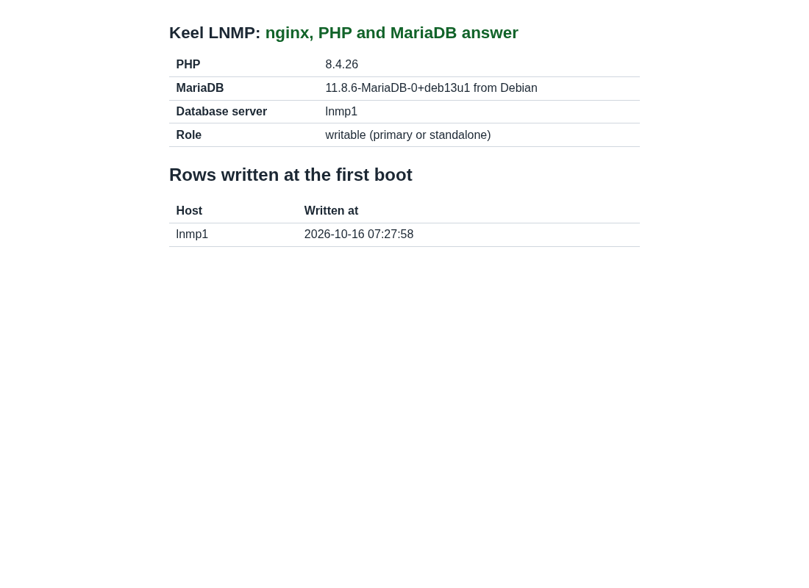
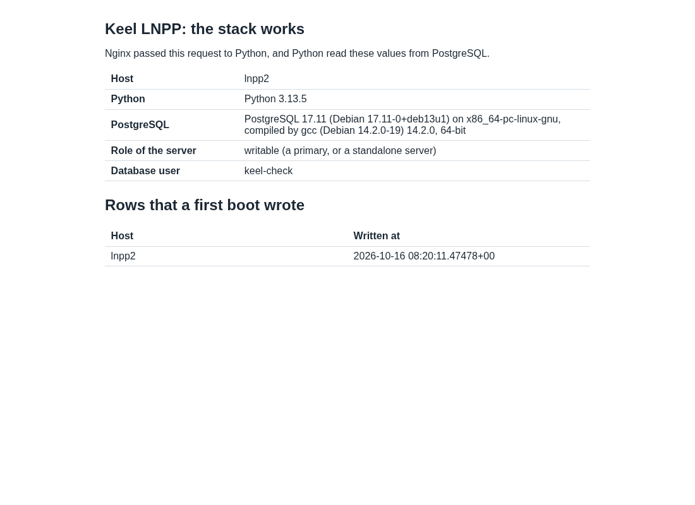
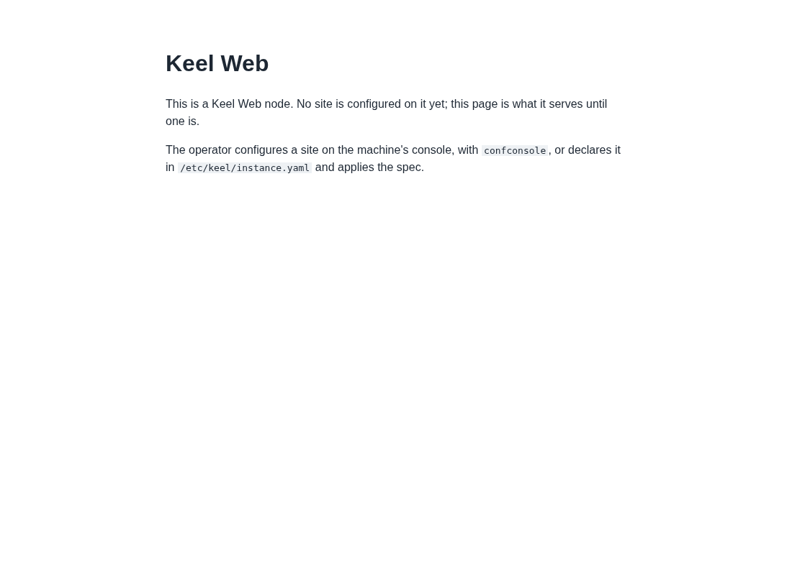
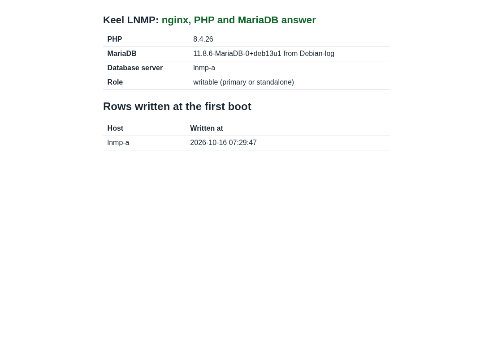
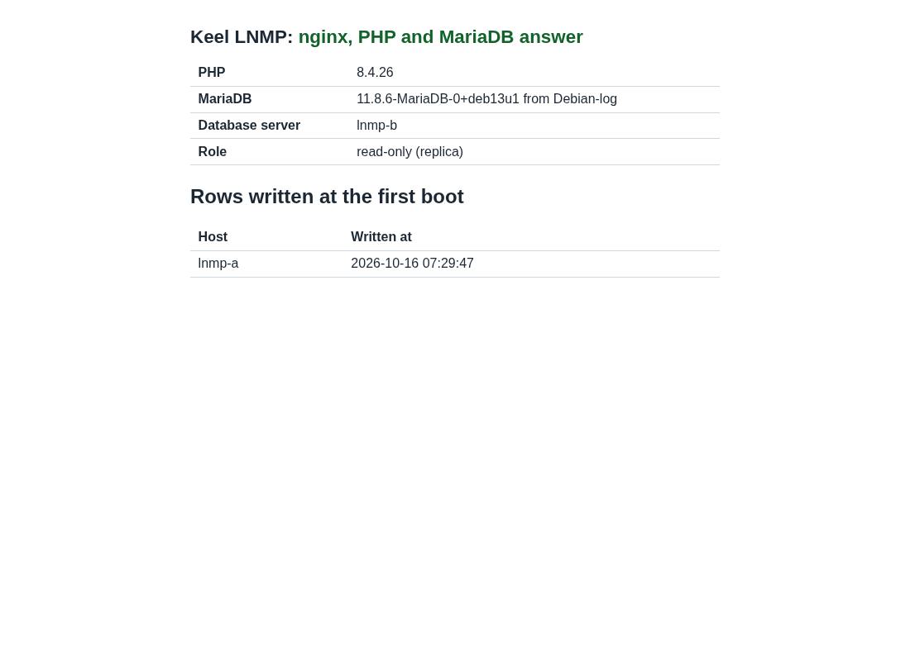
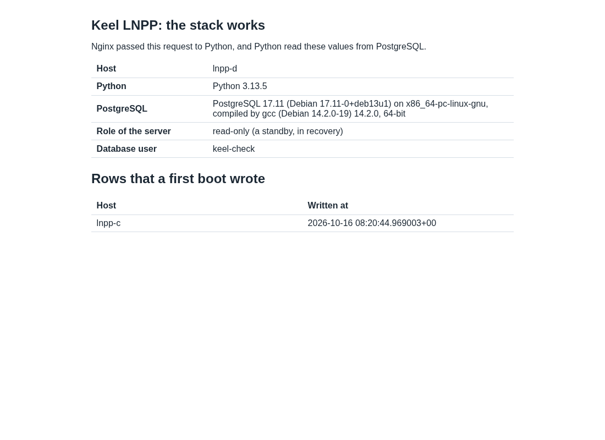

# Evidence: the LNMP and LNPP images, built, signed and booted (2026-10-16)

Decision 0059 (handbook#90): nginx is the only web server, and LNMP and
LNPP are the base stacks. This file records the build, the signatures,
the publication as testing pre-releases, and the tests on hw12-br1.
The time zone is UTC.

## Result

| Image | sha512 (first 16) | Standalone | Pair |
| --- | --- | --- | --- |
| `debian-13-keel-lnmp_19.0-2_amd64.tar.zst` | `874d02ccddca5439` | PASS (CT 9081) | PASS (CTs 9083, 9084) |
| `debian-13-keel-lnpp_19.0-2_amd64.tar.zst` | `d811fca9bb02e089` | PASS (CT 9087) | PASS (CTs 9088, 9089) |

PASS means:

- The first boot completes headless from an instance spec.
- The stack answers over HTTPS with the machine's certificate.
- The check page `/keel-check/` shows the language, the database
  server and the row that the first boot wrote.
- `keel diff` reports no drift on a standalone node. On a pair, the one
  drift is keel#106, see "Findings".

## What changed, in merge order

| PR | What |
| --- | --- |
| handbook#90 | Decision 0059 |
| keel-web#12 | keel-web 0.3.0: `/etc/nginx/keel-default.d/*.conf` in the default site and in the server behind Anubis |
| apt#36 | keel-web 0.3.0 published to trixie-testing (build host publish commit) |
| apt#35 | `conf/appliances`: `lnmp web`, `lnpp web`; the Apache layers removed |
| keel-lnmp#1, keel-lnpp#1 | The two recipes, with the check pages, the CI `stack` jobs and the boot test |
| keel-lnmp#2 | The plan without `webmin-phpini`, which no archive has (the first build stopped) |
| keel-lnpp#2 | The check database keeps CONNECT for PUBLIC (the pair test found it, see "Findings") |
| keel-lnmp#3 | The pair example names the overlay address in `listen` (the pair test found it) |
| keel-web#13 | README text for the include directory |

The two repositories are new on git.pop.coop: `Keel-Linux/keel-lnmp`
and `Keel-Linux/keel-lnpp`. Each has a push mirror to GitHub with its
own deploy key, Actions, issues and pull requests off on GitHub, and
branch protection on `main` with the checks of the first green run.

## The appliance gate

Until 2026-10-16 the organization variable `KEEL_LXC_RUNNER` was not
set on git.pop.coop, so the `appliance` job was skipped and reported
success. keel-web#12, keel-lnmp#1 and keel-lnpp#1 merged in that state.
After the variable came back:

- keel-web#13: the gate booted the published web layer, upgraded to
  keel-web 0.3.0 from trixie-testing: "keel diff: no drift, but a
  declared field could not be observed offline".
- keel-lnmp#3 and keel-lnpp#2: the gate ran on `keel-lxc` and said
  "lnmp.manifest answers 404 and this caller declares
  allow_unpublished, so nothing is built, assembled or booted". The
  layers are not on the mirror, so the boot proof of these two images
  is this file.

## Build and signatures

Build host `tkldev`, tooling `/srv/keel-apt/apt` at apt main, script
`/var/tmp/keel-testbuild/s7/rel.sh` (the s5 flow with root's keyring in
place of an empty one). Release directory `/srv/keel-release/2026-10-16`.

1. web 19.0-6 on the store core 19.0-10: `web rc=0/0`.
2. lnmp 19.0-1: refused at `fab-install`: "E: Unable to locate package
   webmin-phpini". keel-lnmp#2. Then lnmp 19.0-2: `lnmp rc=0/0`.
3. lnpp 19.0-1: `lnpp rc=0/0`. After keel-lnpp#2, lnpp 19.0-2:
   `rc=0/0`.

Each run printed "keel-release: signing with subkey" with 2 subkeys,
and "MANIFEST: signed". keel-release runs the key scan before it signs.

On the workstation, with the public keyrings of apt `keys/`:

```
sha512sum -c debian-13-keel-lnmp_19.0-2_amd64.tar.zst.sha512   OK
sha512sum -c debian-13-keel-lnpp_19.0-2_amd64.tar.zst.sha512   OK
sqv --keyring keel-archive-keyring.asc  (lnmp, lnpp)            good, good
sqv --keyring keel-images-keyring.asc   (lnmp, lnpp)            good, good
sqv with a changed .sha512                                     refused
```

Full digests:

```
874d02ccddca54391159c9cbba74bdf37852776dd67fe1ada1ad569297880d97e13afd5f30aa08562487c6fedaa1328494bc09dc3c8a4f2ca3c4c8aed54e1abe  debian-13-keel-lnmp_19.0-2_amd64.tar.zst
d811fca9bb02e089fa5fafe704b77efe1728f292eedf70ab0db78f901153297402075a562f2de38558170169e3fcab14757eca48ca10f3cd8b6c9ecaec2061b5  debian-13-keel-lnpp_19.0-2_amd64.tar.zst
0df267b46e795867f949801ef58190ba0e9fe6e1b12b0c1401fdb022f0e0fb632cffa9004a07bde20c2fa87ebd6b221128275a3a4f772f2a3fb209c976ace4cb  debian-13-keel-web_19.0-6_amd64.tar.zst
```

Sizes: lnmp 253,455,289 bytes, lnpp 283,891,627 bytes.

## Publication

- keel-web 0.3.0 in trixie-testing: `bin/build-package --native
  --subdir packages/keel-web keel-web master`, `bin/publish` (signed by
  the main and the testing keys), then `keel-publish-mirror
  --archive-only`: "https://archive.keellinux.org trixie-testing
  verifies". trixie (stable) is not changed.
- The images are pre-releases `testing-19.0-2-20261016` on git.pop.coop
  `Keel-Linux/keel-lnmp` and `Keel-Linux/keel-lnpp`: the `.tar.zst`,
  its `.sha512` and the `.sha512.asc`. The tags are on git.pop.coop
  first, and the mirror carries them to GitHub. The mirror's
  `layers/`, `images/` and the Proxmox index are not changed. The
  public stable index is not changed.
- A copy is on the workstation in `~/keel-test-images/2026-10-16/`.
- keel itself is not released. The images carry keel 0.23.29 from
  trixie-testing.

## The test harness on hw12-br1

New CTs only. CTs 9054 and 9062 are not touched, and nothing is
removed. Pattern of step 12: unprivileged, `nesting=1`, `local-lvm:8`,
2 GB, net0 on `vtnet88` VLAN 5 with DHCP and IPv6.
`/root/lx/br1-ct.sh` does what the boot test of the recipes does:

1. It writes the spec to `/etc/keel/instance.yaml` and
   `/etc/inithooks.yaml`, with random root and database passwords as
   secret files.
2. It renders `/etc/inithooks.conf` with the keel of the image, inside
   the CT's user namespace (`lxc-usernsexec`). keel refuses a hook that
   root does not own, and from the host the files belong to uid 100000.

Versions on the CTs: keel 0.23.29, keel-core 0.1.3, keel-web 0.3.0,
anubis 1.27.0-0+keel3, inithooks 2.3.6+keel26, confconsole 2.2.3+keel15,
nginx 1.26.3-3+deb13u9. LNMP: mariadb-server 1:11.8.6-0+deb13u1,
php8.4-fpm 8.4.26-1~deb13u1. LNPP: postgresql-17 17.11-0+deb13u1,
gunicorn 23.0.0-1, python3-psycopg 3.2.6-1. No package with "apache"
in its name is installed on either image.

## Standalone, simple mode

| | lnmp1 (CT 9081) | lnpp2 (CT 9087) |
| --- | --- | --- |
| First boot | 07:27:51 to 07:28:00, "Inithooks run completed" | 08:19:54 to 08:20:14 |
| Failed units | `systemd-modules-load` only (expected in an unprivileged LXC) | the same |
| Database | `mariadb` active, `127.0.0.1:3306` and `[::1]:3306` only | `postgresql@17-main` active, `127.0.0.1:5432` and `[::1]:5432` only |
| Application | `php8.4-fpm` on `/run/php/php8.4-fpm.sock` | `keel-lnpp-check.socket` on `/run/keel-lnpp/check.sock`, gunicorn as `keel-check` |
| `keel inspect` | `appliance.name: lnmp` | `appliance.name: lnpp` |
| `keel diff` | "15 same, 0 drift ... no drift" | "15 same, 0 drift ... no drift" |
| HTTPS | 200, HTTP/2, TLS 1.3, `CN=lnmp1.keel.test` | 200 |

Other checks on lnmp1: `/keel-check/other.php` answers 404 (only
`index.php` reaches PHP). On LNPP a POST answers 403.





## Pairs, cloud simple

Each pair is 2 CTs on hw12-br1 with `installation.mode: cloud_simple`,
Coraza, Anubis and CrowdSec enabled. The steps:

1. Boot the primary. Run `keel mesh create` and `keel mesh invite`.
2. Boot the replica with `role: replica` and
   `replication.primary.host` set to the primary's overlay address.
   Thus the first boot of the replica writes no check database.
3. Run `keel mesh join` on the replica, then `keel mesh sync` on both.
4. Copy the Anubis key of the primary to the replica, and declare it
   as `secrets.anubis_signing_key`.
5. Declare `appliance.vip` with the `wireguard` and `vip` overlays on
   both nodes, then run `keel vip pair` on both.
6. Run `keel spec apply --system-only` on the primary, `keel vip
   promote` on the primary, then `keel spec apply --system-only` on the
   replica.

### LNMP: lnmp-a (CT 9083) and lnmp-b (CT 9084)

```
keel mesh create      created the mesh: this node is fd98:a500:292e::1/64 on wg0
keel mesh join        joined the mesh: this node is fd98:a500:292e::3211/64 on wg0
keel vip pair         fd98:a500:292e::ffff:1 is the VIP of <a> and <b>, signed by both
keel vip promote      this node holds fd98:a500:292e::ffff:1 at epoch 1, on wg0
[b] apply             database.server.role: seeded from [fd98:a500:292e::1]:3306 and replicating from it over TLS
[b] status            read_only: true; replicating from [fd98:a500:292e::1]:3306; IO Yes, SQL Yes; lag 0; TLS Yes
[a] status            read_only: false; 1 replica(s) acknowledging; 1 replica(s) connected
[b] SELECT ... boot   lnmp-a  2026-10-16 07:29:47
```

The first apply on the replica failed: "the primary
[fd98:a500:292e::1]:3306 did not answer as 'repl' (ERROR 2002)". The
spec, from the pair example of keel-lnmp#1, declared `listen` as the
two loopbacks only. keel binds the declared `listen` plus the VIP, so
the primary did not listen on its overlay address. With `listen`
removed from both specs, keel binds the overlay address, the loopbacks
and the VIP, and the second apply seeded the replica. keel-lnmp#3
corrects the example.

Through Anubis, the replica's page shows the primary's row and
"read-only (replica)". HTTP answers 301 to HTTPS. A request with
`<script>` in the query answers 403 from Coraza.




### LNPP: lnpp-c (CT 9088) and lnpp-d (CT 9089), image 19.0-2

```
keel mesh join        joined the mesh: this node is fd73:91ce:d3a8::9d5c/64 on wg0
keel vip promote      this node holds fd73:91ce:d3a8::ffff:1 at epoch 1, on wg0
[d] apply             refused: diverged: this node holds transactions the holder ... lacks; ... --destroy-local-database reseeds it
[d] apply --destroy-local-database
                      seeded from [fd73:91ce:d3a8::1]:5432 and streaming from it over TLS
[d] pg_is_in_recovery, wal receiver   t | streaming
[c] pg_stat_replication               keel | streaming | sync
[d] SELECT ... boot                   lnpp-c | 2026-10-16 08:20:44
```

A new replica is a cluster of its own, so keel asks the operator to
confirm the reseed (0013, 0054). keel keeps a dump of the replica
first, in `/var/backups/keel/postgresql/`.




## Findings

1. **keel#183 (new).** The first LNPP pair (image 19.0-1, CTs 9085 and
   9086) did not reseed: "cannot ask [fd0b:d5b0:6fcd::1]:5432 as repl:
   ERROR: permission denied for database keel_check". keel's reseed
   probe asks `pg_database_size()` of every database as `repl`, and
   that needs CONNECT. keel-lnpp#2 keeps CONNECT for PUBLIC, and image
   19.0-2 passed. keel must not need CONNECT on every database.
2. **keel#106 (known).** On a cloud simple pair `keel diff` reports
   `overlays.vip: drift (declared enabled, observed keel-vip.service
   enabled and inactive)`. The unit needs etcd's `cluster.json`.
3. **The Anubis key of a replica.** `keel-overlay-anubis-key` makes no
   key on a database replica: "the key is shared and comes from the
   primary". Nothing copies it, so `anubis@keel` does not start until
   the operator copies the key (step 4 above). A pair procedure needs
   this step written, or a copy over the members' channel.
4. **Anubis refuses headless Chromium** by its user agent ("Access
   Denied"). The screenshots use a desktop user agent. curl gets the
   page, as the bot policy allows it.
5. **A first boot spec of IPv6 `dhcp`** gave `keel diff` drift on
   hw12-br1 (`declared dhcp, observed auto`): the VLAN gives SLAAC
   only. The specs here declare `auto`. This is the harness, not the
   image.
6. **keel-web#13 CI.** The `site` job stopped at its 30 minute limit
   during `apt-get install`, the first time the runners also ran the
   appliance gates. A second run of the same commit passed every check,
   the gate's boot included, and keel-web#13 merged.

## Left running

CTs 9081, 9083, 9084, 9087, 9088 and 9089 run the delivered images.
CTs 9082, 9085 and 9086 run lnpp 19.0-1, which keel-lnpp#2 replaces.
They are kept for keel#183 and can be removed.
