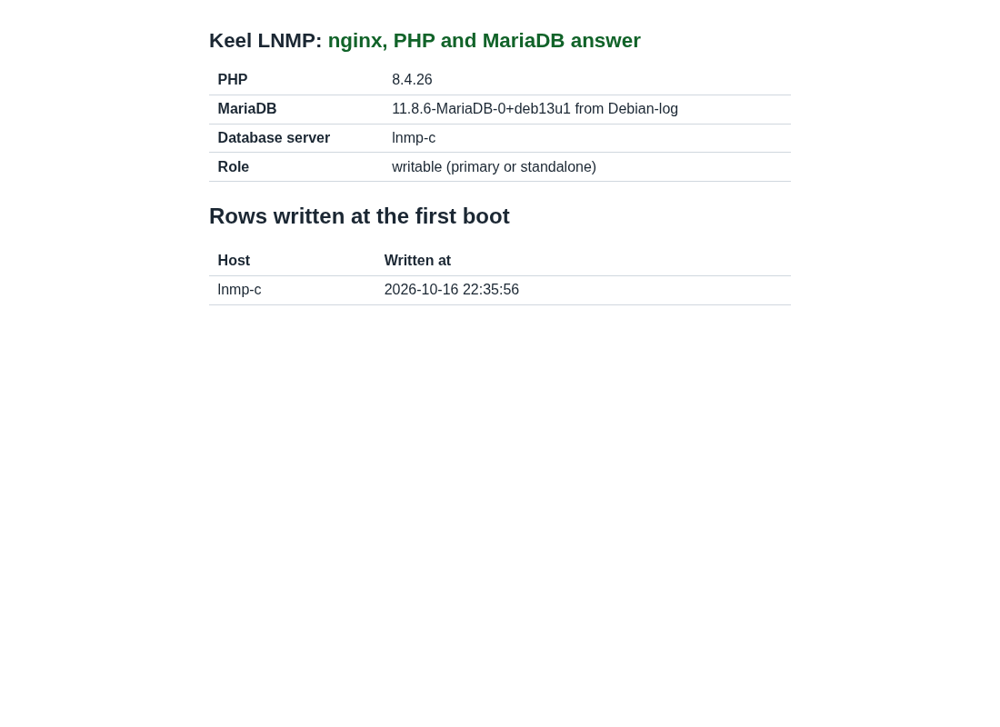
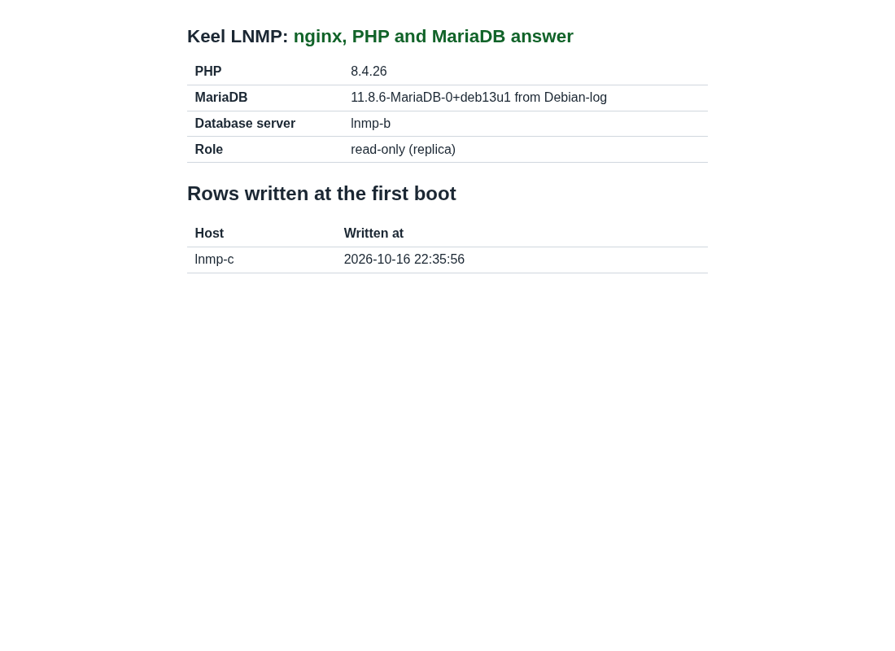

# Evidence: LNMP 19.0-4 and LNPP 19.0-5, the fix of keel#202 and a release test across 2 sites

Date: 2026-10-16 and 2026-10-17. The time zone is UTC.
Decisions: 0031, 0049, 0054, 0057, 0059. The maintainer approved the
task on 2026-10-16. Rule of the maintainer, 2026-10-16: a release test
uses 3 CTs, 2 on BR1 and 1 on BR2, with the database pair across the
2 sites.

No secret is in this file. Output is trimmed.

## Result

| Image | sha512 (first 16) | keel | Result |
| --- | --- | --- | --- |
| `debian-13-keel-lnmp_19.0-4_amd64.tar.zst` | `1ad070d9607af4d4` | 0.23.43 | PASS, every item, with the new item of keel#202 |
| `debian-13-keel-lnpp_19.0-5_amd64.tar.zst` | `4d49c03bc0d906d8` | 0.23.43 | PASS, a shorter run (see "LNPP") |

The test of 19.0-3 found one open defect: the first MariaDB primary
came back from every cut as diverged, also when it took no write
(keel#202). This file records its cause, its fix, the build of the new
images and the test of both.

| Item | Result for LNMP 19.0-4 |
| --- | --- |
| First boot | 3 of 3 CTs complete the first boot headless; `systemd-modules-load` is the only failed unit; keel 0.23.43 on all |
| Mesh and etcd | 3 voters healthy, 2 on BR1 and 1 on BR2 (leader on BR1) |
| Check page | `/keel-check/` answers 200 at the VIP, from W and through Anubis; screenshots of the VIP, B and C |
| Writes replicate | a row written at the VIP on C is on B 2 s later; 14588 rows on both nodes at the end |
| Failover 1, network cut of C | VIP lands on B 19.5 s after the cut; first write acknowledged 1.89 s after the VIP; 0 acknowledged writes on C after the cut; 0 of 3805 ids lost |
| Old primary returns | C is read only and not connected; keel records "diverged" with 1 transaction (the write that waited when the cut came) and keeps a dump |
| Reseed | `--destroy-local-database` on C: seeded, streaming, semi-synchronous again, VIP fence cleared |
| Failover 2, `pct stop` of B | VIP lands on C 18.8 s after the stop; first write 1.13 s after the VIP; 0 of 2417 ids lost; B returns read only and replicates with no operator step |
| netem, cut of C | 250 ms ±25 ms, 1.5 % loss: VIP on B 20.3 s after the cut; first write 1.16 s after the VIP; 0 of 4281 ids lost; reseed works |
| netem, `pct stop` of B | VIP on C 22.5 s after the stop; first write 0.31 s after the VIP; 0 of 2078 ids lost |
| **New:** a cut in which the old primary took no write | C, the first primary, holds its first-boot GTID. After the cut and the heal it returns with "rejoined: no errant GTID" and needs no reseed |
| Firewall | the same input chain on all 3 CTs; 3306 answers on `wg0` only; see "Firewall" |
| End | `keel diff` exit 0 on the 3 CTs; no netem, no test nft table; every one of 14583 acknowledged ids is on both nodes |
| Screenshots | the check page at the VIP, of B and of C |

## The cause of keel#202

The lead from an earlier session said the stray GTIDs come from the
administrative password hook, which writes before the pair forms. The
test checked whether they are in the image or written at the first
boot of the CT. CT 9113 (BR2, first primary of the 19.0-3 test) was
still running.

```
@@server_id 1530113555   gtid_binlog_state 0-1176884288-15908,0-161129940-6,0-1530113555-19469
/var/lib/mysql/mysql/columns_priv.frm        2026-10-16 14:56:37   (the image)
/var/lib/mysql/mariadb-bin.000001            created 17:41:17, server id 161129940
mariadb-bin.000001: GTID 0-161129940-1 to 0-161129940-6 at 17:41:32
mariadb-bin.000002: starts 17:42:11, server id 1530113555, "Gtid list [0-161129940-6]"
uptime -s: 2026-10-16 17:41:07
```

The binary log of the image has no GTID: the data files date from the
build at 14:56, and the binary log starts at the first boot of the CT.
The 6 GTIDs are 3 `ALTER USER 'admin'@...` and 3 `FLUSH PRIVILEGES`
statements, which `35mysqlpass` sends through `mysqlconf.py` 15 s
after the server starts. The server runs with a binary log and a
server id that it derives at that first boot (161129940). At 17:42:11
keel writes the pair configuration. The server id changes to the pair's
(1530113555), and the server restarts.

The replica is seeded with a dump that the load does not log
(`sql_log_bin = 0`). The dump holds the effect of the 6 statements,
but the replica never holds their GTIDs. So the first primary holds
`0-161129940-6` and the holder does not: keel reads one errant GTID
after every cut.

The cause is not the hook alone. Any write of the first boot has the
same effect. So the fix is at the seed.

### The fix, and what the first attempt missed

keel#203 (0.23.42): after the load, the replica runs `RESET MASTER`
and sets `gtid_binlog_state` to the primary's GTIDs under other server
ids than the dump position names, then the position. A scratch server
on a CT accepted the statements and kept the state across a restart.
All checks of the pull request were green.

The first rehearsal on a real pair, with the image built from
keel 0.23.42, showed that the fix did nothing. The replica's
`gtid_binlog_state` was empty. The sampling of `@@log_bin` on B (every
0.3 s during the apply; times are seconds after 1792185600) shows why:

```
13.88  log_bin 0  gtid_slave_pos 0-697584507-6  gtid_binlog_state (empty)   <- the seed
17.37  mariadbd restarts (the pair's configuration)
18.34  log_bin 1  gtid_slave_pos 0-697584507-6  gtid_binlog_state (empty)
```

The promotion of the VIP on C starts `keel database follow` on B
before `keel spec apply` writes the pair's configuration on B. So B
was seeded while it wrote no binary log, and a server can take a binary
log state only while it writes one. keel#204 (0.23.43) makes the follow
wait when `@@log_bin` is 0. The apply then seeds B after the restart
that turns the log on. With this change B holds `0-735055117-6` right
after the seed, and C, cut with no write, rejoined by GTID.

## What changed

Every PR merged with every check green, merge commits only. The
`postgres` job of keel#204 failed once on its first run, and the PR
did not touch PostgreSQL. The PR was reopened, the checks ran again,
and all passed. The
`appliance` gate of keel-lnmp and keel-lnpp cannot boot these layers
(they are not on the mirror), so the boot proof is the real nodes of
this file.

| PR | keel | Issue | What |
| --- | --- | --- | --- |
| handbook#101 | | | The maintainer's "segue": 30 s semi-synchronous timeout and the read only holder at 6 s (0031, 0049) |
| keel#203 | 0.23.42 | keel#202, #198, #201 | The seed starts the binary log at the history of the copy; the join message; keel diff counts only senders with a client address |
| keel#204 | 0.23.43 | keel#198, #202 | The join names the failed step; the follow waits for the binary log before it copies the holder |
| keel-lnmp#5 | | | Changelog 19.0 (4) |
| keel-lnpp#5 | | | Changelog 19.0 (5) |
| apt#44, apt#45 | | | The publish commits of keel 0.23.42 and 0.23.43 |

The small issues:

- keel#198, the misleading join message. The first fix asked whether
  `etcd.service` was active. On the real node etcd is not active yet at
  that point of a join: it starts when the cluster forms. So the
  message stayed. The second fix reads the failed lines of the apply.
  Real node: "etcd: apply exited 16; the failed step is not etcd's:
  database.server.replication.primary".
- keel#201, the keel side. The role query counts only the rows of
  `pg_stat_replication` with a client address. A sender on the local
  socket has none. See "LNPP" for what the test could check.
- keel#167 is not touched. It stays open: BR3-THIN is offline.

The decision note: the maintainer answered "segue" to the amendment of
0031 on 2026-10-16. The note now says so, with the measured basis (the
server went read only 6.1 s to 8.8 s after a cut).

## Build and signatures

keel 0.23.43 was built from `main` on the build host and published to
trixie-testing only, signed by the main key and by the testing key with
nobody at a keyboard (decision 0055). `trixie` still has keel 0.23.21.

```
# build host, /srv/keel-apt/apt
$ bin/build-package --native keel main </dev/null      # 0.23.42, then 0.23.43
$ bin/publish </dev/null
publish: committed in /srv/keel-apt/apt: publish trixie-testing: keel 0.23.43
# workstation
$ keel-publish-mirror --archive-only
$ curl -s https://archive.keellinux.org/dists/trixie/main/binary-amd64/Packages         | grep -A1 '^Package: keel$'   Version: 0.23.21
$ curl -s https://archive.keellinux.org/dists/trixie-testing/main/binary-amd64/Packages | grep -A1 '^Package: keel$'   Version: 0.23.43
```

The images came from keel-release on the build host, release
directory `/srv/keel-release/2026-10-16`, on Core 19.0-10 and Web 19.0-6
(keel-web 0.3.0). Sources: keel-lnmp 9ed7a2b, keel-lnpp f8b8640.

Four build traps cost time. They are known now:

- A layer whose tarball matches its manifest is not built again, also
  when a package changed. The first build used `--rebuild`.
- `--rebuild` rebuilds the whole chain for each appliance of the run.
  Two appliances in one run rebuilt Core and Web twice, and `keel
  verify` refused the layers because the first appliance was built on
  the first Web. The way out: one `--rebuild` for the first appliance,
  then `--match-source` for the second.
- An image of the same name that is already assembled is kept. The
  unpublished 19.0-4 and 19.0-5 images built with keel 0.23.42 were
  moved to `/srv/keel-release/withdrawn-2026-10-16-keel-0.23.42`.
- The product checkouts in `/turnkey/fab-keel/products/*` are not
  pulled by the build. The first build had the old changelog and the
  old image name.

```
sha512sum -c debian-13-keel-lnmp_19.0-4_amd64.tar.zst.sha512   OK
sha512sum -c debian-13-keel-lnpp_19.0-5_amd64.tar.zst.sha512   OK
sqv --keyring keel-archive-keyring.asc   (lnmp, lnpp)   AD0964BE3F09DED469A3B6B2148E951314703180
sqv --keyring keel-images-keyring.asc    (lnmp, lnpp)   E71DB9C3CA6AC18075395CC3ED3A709C4F3E2F3C
```

Full digests:

```
1ad070d9607af4d4d19bf61bb3d73f6e914163a972c980e6f41f7a75aec538361bb1e49b9c506c9fa2c3e136f70daa17568592566ef7c4006bc7738ee8450b21  debian-13-keel-lnmp_19.0-4_amd64.tar.zst
4d49c03bc0d906d81162ee9c7cf3a08b57c3bfff546e48e36be965cb5a367681ac6cb23b04b65419c0d357f9dfa523cfefeb71a4ca9074197d2fcb18fac21c51  debian-13-keel-lnpp_19.0-5_amd64.tar.zst
```

Sizes: lnmp 253,402,083 bytes, lnpp 282,860,184 bytes. The Forgejo
pre-releases are `testing-19.0-4-20261016` on Keel-Linux/keel-lnmp and
`testing-19.0-5-20261016` on Keel-Linux/keel-lnpp. The stable index is
not changed.

## The test

BR1 is hw12-br1, BR2 is nfs1-br2. BR3-THIN is offline, so the test cuts
the CT of the primary and never the whole BR1 site (2 of the 3 voters
are on BR1).

| | BR1, witness | BR1, pair node | BR2, pair node |
| --- | --- | --- | --- |
| LNMP | 9131 `lnmp-w` | 9132 `lnmp-b`, replica at installation | 9133 `lnmp-c`, primary at installation |
| LNPP | 9141 `lnpp-w` | 9142 `lnpp-b`, replica at installation | 9143 `lnpp-c`, primary at installation |

The method is the one of the 19.0-3 test. The test changes only the
network of a CT (an nft table, `tc netem` on the BR2 CT), the power of
a CT (`pct stop`, `pct start`), the test tools under `/root/logs`, and a
test database with its writer account. Every product step is a keel
command.

### The new item

The first primary C holds `0-1851169589-6`, its first-boot GTID
(written at the first boot, server id 1851169589). The pair formed at
22:38:07, with server id 878615092. No writer ran. The cut of C came
at 1792190901.7.

```
  +7.0 s   the holder marks the doubt of its lease (6 s without a renewal)
  +8.1 s   C is read only
 +12.6 s   C drops the VIP
 +21.0 s   the VIP lands on B
 +22.3 s   B is writable
 +70.5 s   heal
 +73.8 s   C: "rejoined: no errant GTID, replicating from [...] over TLS from 0-878615092-13"
```

No reseed, no `--destroy-local-database`. After the rejoin
`keel vip status` on C shows no fence. A planned failback then worked:
`keel vip promote` on C asked B to release the VIP and C held it at
epoch 3.

In the 19.0-3 test the same step said "diverged ... 0-161129940-6,
0-1530113555-212". In this test, after a cut with writes, the
divergence names one transaction of the pair's own server id (the write
that waited for the replica when the cut came) and never the first-boot
GTID:

```
round 1: this node holds 1 transaction(s) the holder lacks (domain 0, server id 878615092, up to sequence 314)
```

After each reseed `gtid_binlog_state` is the same on both nodes:
`0-1851169589-6,0-878615092-313,0-79343381-3819` on B and
`0-878615092-313,0-1851169589-6,0-79343381-3819` on C. The reseed also
clears the state that a reseeded node kept (the second part of
keel#202).

### The failover rounds

Writers ran on both pair nodes: one through the local socket and one
through the VIP, each row every 0.1 s, only while the node carries the
VIP, killed after 45 s. An id counts as acknowledged only when the
client returned 0. Times are in seconds after the fault.

| Round | Fault | Network | VIP left the old holder | VIP landed | First write after the VIP | Acks on the old holder after the fault | Acked ids missing on the survivor | Old holder returns |
| --- | --- | --- | --- | --- | --- | --- | --- | --- |
| 1 | cut of C (the holder) | base | +11.9 | +19.5 | 1.89 s | 0 | 0 of 3805 | read only, "diverged" by 1 transaction, dump kept; reseed |
| 2 | `pct stop` of B (the holder) | base | stopped | +18.8 | 1.13 s | 0 | 0 of 2417 | read only, replicates by itself, no reseed needed |
| 4 | cut of C (the holder) | netem | +12.9 | +20.3 | 1.16 s | 0 | 0 of 4281 | read only, "diverged" by 1 transaction, dump kept; reseed |
| 5 | `pct stop` of B (the holder) | netem | stopped | +22.5 | 0.31 s | 0 | 0 of 2078 | read only, replicates by itself, no reseed needed |

All acknowledged ids of all rounds (14583) are on B and on C, and both
nodes hold 14588 rows. In rounds 1 and 4 the writes that waited on C
when the cut came got an error after 7.0 s and 7.5 s at most (the
fence ended their connections), and none was acknowledged.
Rounds 2 and 5 are the second failover in a row (after round 1 and
round 4).

Round 3 is void. It was a cut of C under netem, and its writers took
ids that round 2 had used, so B answered `ER 1062` (duplicate key) for
183 s. The first write of round 3 is not a product figure: it counted
184 s only because of that. The round was run again as round 4 with
new ids. Round 3 acknowledged 2002 ids, and none is missing.

The netem profile on the BR2 CT: `delay 250ms 25ms loss 1.5%`. Overlay
ping W to C: 231 / 252 / 273 ms (min / avg / max), 0 of 30 lost, 3
etcd voters healthy.

After round 1 the failback of the VIP to C (`keel vip promote`) was the
planned step that put C in the holder's place for round 4.

### Firewall

The input chain of `inet keel` is the same on W, B and C (policy
drop):

```
tcp 22, 80, 443, 12321; udp 51820
iifname wg0: tcp 2379, 2380, 3306, 51821
@mesh_invites
```

Probes from W (a CT of BR1) and from the workstation:

| From | To | Open | Closed |
| --- | --- | --- | --- |
| W | the VIP and the overlay addresses of B and C | 22, 80, 443, 12321, 3306; overlay also 51821, 2379, 2380 | 51820 (UDP), 8923, 9999 |
| W | public address of B | 22, 80, 443, 12321 | 3306, 51820, 51821, 2379, 2380 |
| workstation | public addresses of W and B | 22, 80, 443, 12321 | 3306, 51820, 51821, 2379, 2380, 8923 |
| W and workstation | public address of C | 22 | all others (the upstream filter of BR2) |

The database port is open on `wg0` only.

### Screenshots

The pages are read through Anubis with a headless Chromium. The
script maps the node's name to a local port that reaches the node
through the witness. Each page was read and checked.





At the time of the screenshots C held the VIP: the VIP page and the
page of C say "writable (primary or standalone)" and B says "read-only
(replica)". The row written at the first boot is `lnmp-c`.

## LNPP

LNPP 19.0-5 differs from the tested 19.0-4 only by keel 0.23.43. The
MariaDB fixes of 0.23.42 and 0.23.43 do not touch PostgreSQL, so this
run is shorter: first boot, mesh and etcd, the pair, one network cut
of the holder and one `pct stop` of the holder, both at base.

| Item | Result for LNPP 19.0-5 |
| --- | --- |
| First boot | 3 of 3 headless; `systemd-modules-load` is the only failed unit; `pg_receivewal@17-main` is disabled and inactive on all 3 |
| Pair | C primary, B in recovery and streaming over TLS, `keel|streaming|sync`; the check page answers 200 on C |
| Failover, cut of C | VIP lands on B 21.5 s after the cut; first write 1.66 s after the VIP; 0 of 1469 ids lost; C returns read only and diverged (timeline 1 against 2); reseed works |
| Failover, `pct stop` of B | VIP lands on C 17.0 s after the stop; first write 1.77 s after the VIP; 0 of 997 ids lost; B's server stays stopped until the VIP decides, then the reseed works |
| End | `keel diff` exit 0 on W, B and C; the pairtest rows are equal (2467 rows on both nodes); `keel|streaming|sync` |

A local sender, the second part of keel#201, could not be made on the
witness: the `pg_hba.conf` that keel writes refuses a replication
connection from the local socket (`no pg_hba.conf entry for
replication connection from host "[local]"`). So this test shows that
the new query runs on all roles and that `keel diff` is clean. It does
not show a sender without a client address. The unit test covers the
text of the query, and the PostgreSQL manual says a connection on the
local socket has no client address.

## Open

- keel#167 stays open. It needs BR3-THIN (3 sites), which is offline.
- The `appliance` gate of keel-lnmp and keel-lnpp cannot boot the
  layers until they are on the mirror. The real nodes are the boot proof.
- The ids of a round must not overlap the ids of an earlier round. The
  harness now takes a new base for each round.
- The harness slip: a push of a branch of keel went to the GitHub
  mirror by mistake (the clone of keel still had GitHub as `origin`).
  The branch was deleted from GitHub at once. `main` of GitHub never
  changed. The work uses the `forgejo` remote now.

CTs left running: 9131, 9132 (BR1) and 9133 (BR2) for LNMP, and 9141,
9142 (BR1) and 9143 (BR2) for LNPP. The old test CTs 9111, 9112, 9121,
9122 (BR1) and 9113, 9123 (BR2) were removed after the new ones passed.
