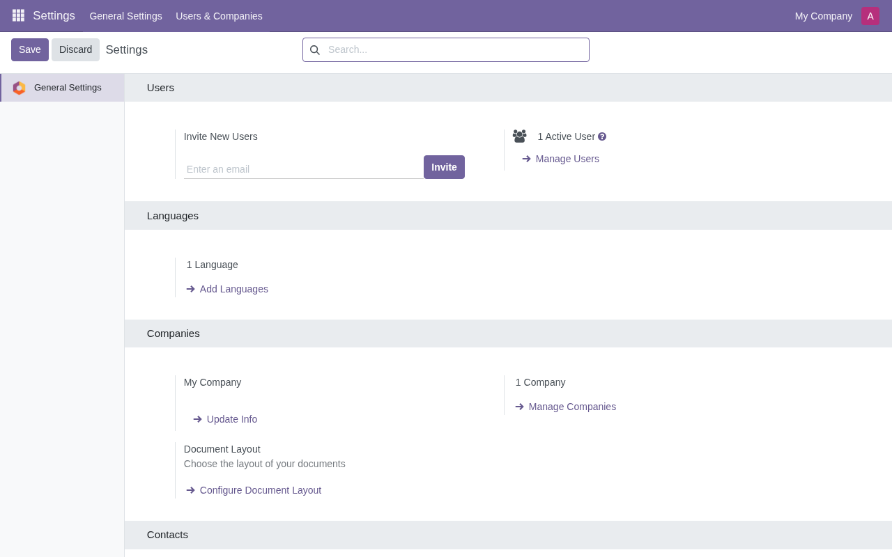
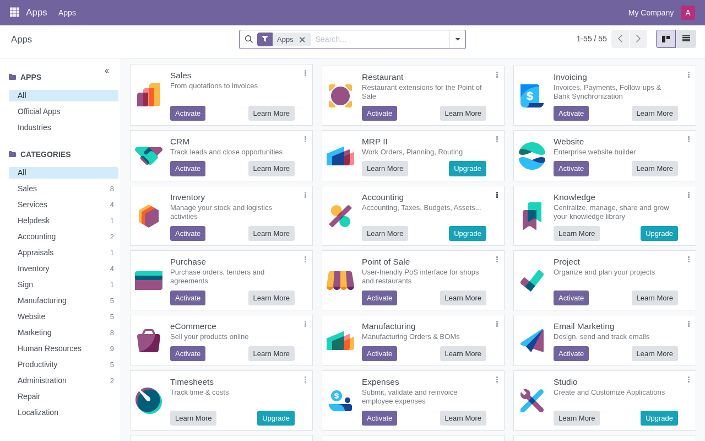
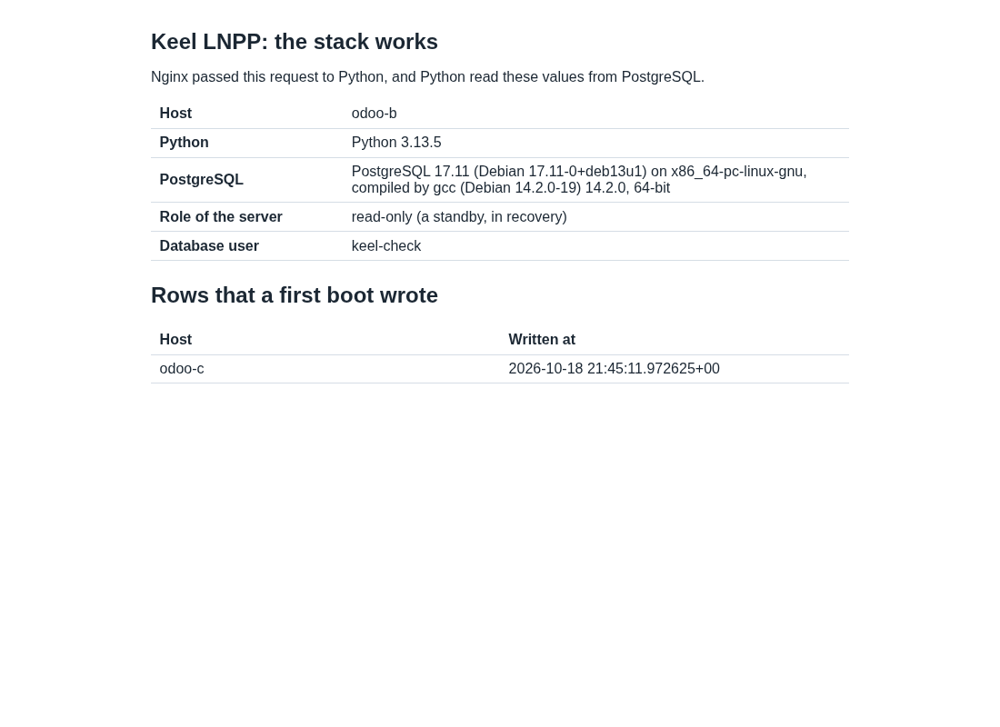
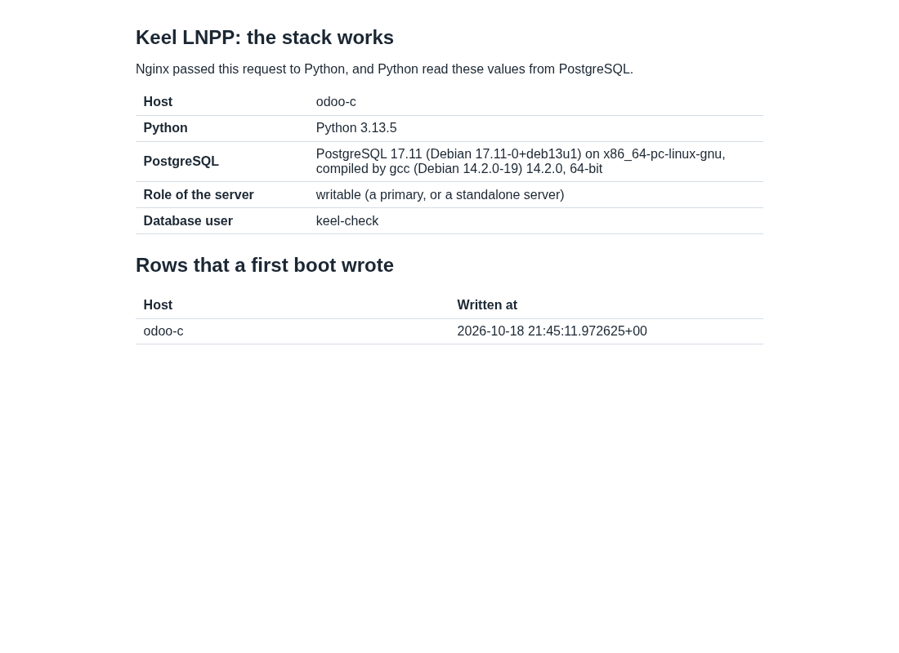

# Evidence: Odoo 19.0-7, the websocket, the start after a failover, PDF reports and uploads, a release test across 2 sites

Date: 2026-10-18. The time zone is UTC.
Decisions: 0022, 0054, 0059, 0061. The maintainer approved the task on
2026-10-18: fix the three gaps of the Odoo 19.0-2 test (the websocket
behind Anubis, the slow start of Odoo after a failover, no PDF reports).
Rule of the maintainer, 2026-10-16: a release test uses 3 CTs, 2 on BR1
and 1 on BR2, with the database pair across the 2 sites. The previous
test is `2026-10-18-odoo-nginx-cross-site.md`.

No secret is in this file. Output is trimmed. Test passwords are random.

## Result

| Image | sha512 (first 16) | keel | Result |
| --- | --- | --- | --- |
| `debian-13-keel-odoo_19.0-7_amd64.tar.zst` | `61a53898457607dc` | 0.23.45 | PASS for the 3 gaps and for every item of the 19.0-2 test. Two findings are under "Open" |

| Item | Result for Odoo 19.0-7 |
| --- | --- |
| The image is the gated image | The image build per merge (decision 0061) built it from keel-odoo `5cb18cf`, booted it in the gate (image-gate run 25: the Odoo boot test passed, with the new checks of the websocket and of the PDF), signed it with the release keys and put it in testing. The 3 CTs started from those files: the sha512 of the file on both PVE hosts is the sha512 of the file in testing and of the staged file that the gate booted |
| First boot | 3 of 3 CTs complete the first boot headless from a spec; `systemctl --failed` is empty on all 3 (19.0-2 had `systemd-modules-load`); keel 0.23.45 on all |
| Gap 1, the websocket | `GET /websocket` with the upgrade headers answers 101 through the front at the VIP in the mode cloud advanced (HTTP/1.1, as a browser does). It answered 400 in 19.0-2. A browser with no Anubis cookie still gets the challenge. A headless Chromium logs in through Anubis: the server logs `GET /websocket 101` and the page has 0 "Connection lost" banners (screenshot) |
| Gap 2, the start of Odoo after a failover | A login and a first write answer 4.37 s, 4.47 s, 4.78 s and 6.70 s after the VIP lands, in 4 rounds. 19.0-2 needed 8.71 s to 16.97 s. Odoo serves 0.2 s to 0.9 s after PostgreSQL accepts writes. The round with 6.70 s has the new holder behind the link of 250 ms. See "The start of Odoo" |
| Odoo never serves on a node that is not writable | After each of the 4 rounds, the old holder was in recovery or fenced, `serve.py` was waiting with no listener, and the login page of that node answered 502 (`odoo.service` is `active` on a node that waits). The database writers had 0 acknowledged writes on an old holder after the cut. 0 of 1615 acknowledged Odoo writes are missing on the 2 nodes |
| Gap 3, PDF reports | `wkhtmltopdf 0.12.6.1 (with patched qt)` is on all 3 CTs. A report on the layout of Odoo prints at the VIP as a PDF with the body, the header (the company name) and the footer (the page number). The gate reads the same in its boot test. See the PDF |
| Uploads | An attachment of 1 MiB and of 10 MiB, as `multipart/form-data` and as a JSON-RPC call with base64, passes the front at the VIP, in the mode cloud advanced. See "Uploads" |
| Mesh and etcd | 3 voters healthy, 2 on BR1 and 1 on BR2 |
| Check page | `/keel-check/` answers 200 at the VIP, on B and on C (screenshots) |
| Odoo login at the VIP | Anubis, Coraza and Nginx in front. Headless Chromium logs in as `admin`, the Apps list, the Users list, a new partner and the Settings app load, and no response has a status of 400 or more |
| Writes replicate | the attachment and every partner of the Odoo writer are on both nodes; 4367 acknowledged database ids and 1615 acknowledged Odoo ids are on both nodes |
| Filestore | Attachments are in the database: 0 rows with `store_fname` and no `/var/lib/odoo/filestore` on both nodes. The file of 400000 bytes that was uploaded at the VIP before the first failover has the same sha256 (`72b01af2ed5da7cc`) after 4 failovers, read from the new primary |
| Failover 1, network cut of C, base | VIP lands on B 21.44 s after the cut; first DB write 1.96 s after the VIP; 0 acknowledged writes on C after the cut; 0 of 1390 ids lost; Odoo write 4.37 s after the VIP; 0 of 526 Odoo writes lost |
| Failover 2, `pct stop` of B, base | VIP lands on C 20.14 s after the stop; first DB write 2.24 s; 0 of 1101 ids lost; Odoo write 4.47 s; 0 of 475 Odoo writes lost |
| Failover 3, network cut of C, netem | 250 ms ±25 ms, 1.5 % loss: VIP on B 20.13 s after the cut; first DB write 1.90 s; 0 of 915 ids lost; Odoo write 4.78 s; 0 of 397 Odoo writes lost |
| Failover 4, `pct stop` of B, netem | VIP on C 19.54 s after the stop; first DB write 2.54 s; 0 of 961 ids lost; Odoo write 6.70 s; 0 of 217 Odoo writes lost |
| Old holder returns | After each of the 4 rounds the old holder came back in recovery with Odoo stopped, and `keel spec apply --system-only --destroy-local-database` finished in 4 s to 5 s with the node streaming in sync (the keel 0.23.45 rejoin; I did not check how it does it) |
| A primary that took no write | Round A (netem still on C by a slip of the harness): the new holder B promoted only 417 s after the VIP landed. Round B (no netem): C promoted at the moment the VIP landed, and the old holder B came back in recovery and streamed in sync, with no reseed. See "Open" |
| Firewall | the same input chain on all 3 CTs; 5432 answers on `wg0` and the VIP only; 8069, 8072 and 8923 are closed everywhere; see "Firewall" |
| End | `keel diff` shows no drift on W, B and C (32, 33 and 33 same, 0 drift); no netem and no test nft table; both nodes hold 4370 test rows and 1615 partners |
| Screenshots | the login page, the web client, the Settings app, the Apps list after the bus opened, and the check pages |

## What changed

Every pull request merged with every required check green, merge commits
only. The tests were written first.

| PR | What |
| --- | --- |
| common#62 | keel-overlay-anubis 0.1.1: the snippet sets `Upgrade` and `Connection` through a map in `conf.d/keel-anubis.conf`. Test in `tests/overlay-web.bats`: the headers reach the app through Anubis and a browser with no cookie still gets the challenge. Closes common#58 |
| keel-web#18 | keel-web 0.3.3 depends on keel-overlay-anubis (>= 0.1.1). Layer 19.0 (9) |
| apt#55 | publish to trixie-testing: keel-overlay-anubis 0.1.1 and keel-web 0.3.3 (signed by the main key and the testing key) |
| keel-odoo#7 | `serve.py` replaces the follow timer; wkhtmltopdf; the upload limits; the image check and the boot test read the PDF. Layer 19.0 (3) |
| keel-odoo#8 | `serve.py` imports the code of the installed modules while it waits; the image check needs the Anubis snippet of 0.1.1. Layer 19.0 (4) |
| keel-odoo#9, #10 | the websocket check of the boot test sends an `Origin` header and opens the handshake over HTTP/1.1. Layer 19.0 (5) |
| keel-odoo#11 | the PDF check of the boot test reads the footer when its words are on separate lines. Layer 19.0 (6) |
| keel-odoo#12 | `serve.py` warms the HTTP workers after a start. Layer 19.0 (7) |

Traps that cost 2 gate runs (both in the boot test, none in the layer):
Odoo answers 400 to a websocket handshake with no `Origin` header, and curl
uses HTTP/2 on HTTPS, which has no `Upgrade` header (run 22); and with
`report.url` set the text of the footer comes out one word to a line, so
the check folds white space (run 23). The gate waits 15 minutes for a check
that cannot pass, so a check of the boot test needs a try on a real CT first.

## Design choices

### The websocket

The front server of Keel Web (`default-anubis`) sent `location /` through
the snippet `/etc/nginx/snippets/keel-anubis.conf` to Anubis. Nginx drops
the hop by hop headers `Upgrade` and `Connection` unless the snippet sets
them, and Anubis hands a WebSocket back to the app only when it gets both.
The snippet now sets both. The map in `conf.d/keel-anubis.conf` sends
`Connection: upgrade` for an upgrade and `close` for any other request.
Anubis still checks the cookie of a request before it hands it over: a
client with no pass gets the challenge, and the test checks that. The image
check fails the build if the snippet of the layer below does not pass the
`Upgrade` header.

A test with curl needs two details: HTTP/1.1 (`--http1.1`, because HTTP/2
has no `Upgrade` header) and an `Origin` header that matches the `Host`
header, which `addons/bus/websocket.py` checks.

### The start of Odoo

Odoo cannot start in a database that is in recovery: its start writes, and
on a standby `odoo-bin` ends with "cannot set transaction read-write mode
during recovery". So a warm Odoo on a standby is not possible, and the
design of 19.0-2 started Odoo from a timer of 3 s on the writable node only.

`odoo.service` now runs `/usr/lib/keel-odoo/serve.py` on every node. It
imports Odoo and the code of every installed module (a read of the
database, which a standby allows), and then it waits. While it waits it has
no listener and writes nothing. Every 0.2 s it asks PostgreSQL one read only
question: is the server out of recovery, and is `transaction_read_only`
off? When the answer is yes, and the first boot hook has written
`/var/lib/keel-odoo/ready`, it forks a child that runs Odoo, and it asks the
login page 4 times so that each HTTP worker has its routing map. When the
answer is no, it stops the child at once. When the server does not answer,
it changes nothing. The gate is the same fact as before (PostgreSQL accepts
writes), asked 15 times faster and stricter (a read only server does not
serve), so it cannot let a fenced or old primary serve. A fenced node is in
recovery, and the tests of `serve.py` cover: a standby waits, nothing starts
before `ready`, a demoted node stops at the next tick, a silent server
changes nothing, and a fenced old primary stays off. The unit tests have 100
percent of lines and branches.

The cost is the memory of a loaded Odoo on a standby: about 100 MB.
Measured on a container of 3 GB: the import of the modules in the waiting
process cut the start from 2.5 s to 0.7 s (fork to login page).

### The PDF reports

Debian 13 has no `wkhtmltopdf`, and the Odoo 18 reports need the build with
patched qt: only that build prints the header and the footer. The layer
installs `wkhtmltox_0.12.6.1-3.bookworm_amd64.deb` of the upstream
packaging project, at the digest `98ba0d157b50d36f` (16,986,150 bytes), with
the libraries of its Depends line from Debian (`libssl3` is provided by
`libssl3t64`). It lands in `/usr/local`. The build and the image check
fail if `wkhtmltopdf --version` does not say "with patched qt". The
parameter `report.url` is `http://127.0.0.1:8069`: without it, the printer
fetches the style sheets from `web.base.url`, which goes through Anubis or
does not resolve (measured: "HostNotFoundError", and a report with no
style). Decision 0022 plans a package of the Keel archive for it. This
layer pins the file until then.

### Uploads

keel-overlay-coraza 0.1.4 refuses a form, JSON or XML body of more than 256
KiB (common#61). The first test showed 3 separate limits:

| Path | Before | After |
| --- | --- | --- |
| multipart, 1 MiB | 413 from the front (the front site takes 1 MB behind Anubis) | `keel-front.d/60-keel-odoo.conf`: 256 MB, as the route |
| JSON-RPC with base64, 1 MiB | 413 from Coraza (256 KiB) | rule 10102: 16 MiB for a POST or PUT of JSON to `/web/dataset/call_kw/`, `/web/dataset/call_button/` and `/jsonrpc` |
| the same, after the limit is raised | 403 after 21.2 s: the rule 930120 (OS file access) finds a path in the random bytes of the file, and the largest Nginx worker grew by 70 MB | `keel-odoo-after.conf`: a static `SecRuleUpdateTargetByTag` takes the base64 fields (`datas`, `db_datas`, `raw`, `image_NNNN`) out of the targets of the Core Rule Set |

A rule at run time (`ctl:ruleRemoveTargetByTag` with a macro) worked, and it
needed 49 s for the same 1 MiB. The static update needs 0.6 s. The other
fields of the same call keep every rule: a SQL injection text in the `name`
field of a `create` still answers 403.

Measured through the front at the VIP, in the mode cloud advanced:

| Upload | Time | Result |
| --- | --- | --- |
| multipart 1 MiB | 0.4 s | 200 |
| multipart 10 MiB | 1.5 s | 200 |
| JSON-RPC with base64, 1 MiB | 0.4 s | 200 |
| JSON-RPC with base64, 10 MiB | 2.7 s | 200 |

The largest Nginx worker had a peak RSS of 59 MB on B and 104 MB on C after
these uploads (a worker of 56 MB at rest). On a test container with the old
rules, a JSON-RPC call of 23 MiB took 5.7 s and a worker of 231 MB, and a
call of 24 MiB was refused. That is why the limit stays at 16 MiB: a file of
about 12 MB by JSON-RPC. A file of any size up to 256 MB goes by multipart,
which is what the web client does for files.

## Build and signatures

keel-odoo `master` at `5cb18cf` was built by the image build per merge on
the build host, on Core (`15f535f`), Web 0.3.3 (`14aea11`) and LNPP 19.0-5
(`f8b8640`), with keel 0.23.45 from trixie-testing. The image is signed by
the main key and by the images key (decision 0055).

```
sha512sum -c debian-13-keel-odoo_19.0-7_amd64.tar.zst.sha512   OK
sqv --keyring keel-archive-keyring.asc   AD0964BE3F09DED469A3B6B2148E951314703180
sqv --keyring keel-images-keyring.asc    E71DB9C3CA6AC18075395CC3ED3A709C4F3E2F3C
```

Full digest:

```
61a53898457607dc0357d86ed7c5e662bee00ff18f5ccc7f851eb3faf40c925ec05f1d912f3de158c9391a916d4ab760ef1a6f506c84d0fef49698a638c9d3df  debian-13-keel-odoo_19.0-7_amd64.tar.zst
```

Size: 511,046,051 bytes. The Forgejo pre-release is
`testing-19.0-7-20261018` on `Keel-Linux/keel-odoo`, with the image, its
`.sha512` and its `.sha512.asc`. The stable index is not changed. The
packages of the Web layer in the image: keel-overlay-anubis 0.1.1, keel-web
0.3.3, keel-overlay-coraza 0.1.4, wkhtmltox 0.12.6.1-3.

## The test

BR1 is hw12-br1, BR2 is nfs1-br2. BR3-THIN is offline, so the test cuts or
stops the CT of the holder and never the whole BR1 site.

| | BR1, witness | BR1, pair node | BR2, pair node |
| --- | --- | --- | --- |
| Odoo | 9144 `odoo-w` | 9148 `odoo-b`, replica at installation | 9149 `odoo-c`, primary at installation |

The method is the one of the 19.0-2 test. The test changes only the
network of a CT (an nft table, `tc netem` on the BR2 CT), the power of a CT
(`pct stop`, `pct start`), the test tools under `/root`, and a test
database with its writer account. Every product step is a keel command.
Two writers ran in each round. The database writers ran on both pair nodes:
one row every 0.1 s through the local socket, only while the node carries
the VIP. An id counts as acknowledged only when the client returned 0. The
Odoo writer ran on the witness: one `res.partner` every 0.5 s through the
VIP, with a login at the start and again after every error. Each round has
its own range of ids (a round needs new bases: the first run of this test
reused the ranges of 19.0-6 and was run again). The Odoo writer of this
test has one change: after an error it probes the VIP with a TCP connect
every 0.1 s before it logs in, and its requests have a time limit of 30 s,
so the measure has no back-off of the TCP SYN and no abort of a slow first
request. The first Odoo writer waited for a connect of 60 s, and its first
write came after the next SYN retry, so the old numbers include a delay of
the client.

### The failover rounds

| Round | Fault | Network | VIP left the old holder | VIP landed | First DB write after the VIP | Acks on the old holder after the fault | Acked ids missing on the survivor | First Odoo write after the VIP | Odoo writes missing |
| --- | --- | --- | --- | --- | --- | --- | --- | --- | --- |
| 1 | cut of C (the holder) | base | +13.15 | +21.44 | 1.96 s | 0 | 0 of 1390 | 4.37 s | 0 of 526 |
| 2 | `pct stop` of B (the holder) | base | stopped | +20.14 | 2.24 s | 0 | 0 of 1101 | 4.47 s | 0 of 475 |
| 3 | cut of C (the holder) | netem | +12.41 | +20.13 | 1.90 s | 0 | 0 of 915 | 4.78 s | 0 of 397 |
| 4 | `pct stop` of B (the holder) | netem | stopped | +19.54 | 2.54 s | 0 | 0 of 961 | 6.70 s | 0 of 217 |

The overlay ping of the witness to C under netem: 232 / 251 / 277 ms
(min / avg / max), 0 of 30 lost, 3 etcd voters healthy. Rounds 2 and 4 are
the second failover in a row of their pair.

### The start of Odoo

Seconds after the VIP lands, from the journal of Odoo on the new holder
and the log of the Odoo writer:

| Round | PostgreSQL writable, Odoo serving | Odoo modules loaded | First warm request answered | First login of the writer | First write of the writer |
| --- | --- | --- | --- | --- | --- |
| 1 | 1.71 | 1.94 | 2.42 | 3.97 | 4.36 |
| 2 | 2.11 | 2.35 | 2.77 | 4.18 | 4.46 |
| 3 | 1.56 | 2.44 | 3.34 | 4.43 | 4.78 |
| 4 | 1.84 | 2.20 | 2.84 | 5.35 | 6.46 |

PostgreSQL needs 1.6 s to 2.1 s to accept writes after the VIP lands. That
time belongs to keel and is not changed here. Odoo serves 0.2 s to 0.9 s
later. The rest is the login: the password check of Odoo (PBKDF2) needs
1.8 s on a container of 2 vCPU, and the first request of a worker needs
0.7 s for its routing map (the new warm requests remove most of it). A
user logs in again after a failover, because sessions are files, and the
login is part of the measure. In round 4 the new holder is behind the link
of 250 ms, so the 10 round trips of the login, the check of Anubis and the
write cost 1.7 s more than in round 3: Odoo is ready at the same time, and
the client waits for the path.

For the comparison: the same method on 19.0-6 (the same design with no
warm request) gave 5.54 s, 3.71 s, 6.86 s and 6.53 s in the same 4 rounds.
The numbers of 19.0-2 (8.71 s to 16.97 s) came from the old writer, which
waited up to 60 s for a connect and so added the back-off of the TCP SYN to
the time of Odoo. A first try with a writer whose requests had a limit of
1 s gave 22.65 s: it aborted the slow first requests of a fresh Odoo and
started again. Both are faults of the measure, and the writer of this test
avoids both.

### A primary that took no write

Two rounds, with no test writer running, cut the holder for 62 s and
heal it. Round A: the holder was C, and netem was still on C by a slip of
the harness (the script reused the name of the variable that `netem_off`
reads). B took the VIP 23.5 s after the cut, and its `keel database
follow` polled the drain of the promotion for 417 s. Odoo stayed off on B
for the whole time, which is the right behavior for a node that is not
writable, and PostgreSQL then promoted at 22:34:53. The old holder C came
back in recovery, kept a dump of what it held (it took no write) and
streamed in sync later. Round B: netem off, the holder B, and C promoted at
the moment the VIP landed (Odoo serving at +0.0 s). B came back in
recovery with Odoo stopped, and 75 s after the heal the pair was `keel
streaming sync` with no `--destroy-local-database` asked. That is the
behavior that keel#202 asks for. The delay of round A is under "Open".

### Firewall

The input chain of `inet keel` is the same on W, B and C (policy drop): tcp
22, 80, 443 and 12321, udp 51820, on `wg0` tcp 2379, 2380, 5432 and 51821,
and the invite ports. Probes from W (a CT of BR1) and from the workstation:

| From | To | Open | Closed |
| --- | --- | --- | --- |
| W | the VIP and the overlay addresses of B and C | 22, 80, 443, 12321, 5432; overlay also 51821, 2379, 2380 | 8069, 8072, 51820 (UDP), 8923, 9999 |
| W | public address of B | 22, 80, 443, 12321 | 5432, 8069, 8072, 51820, 51821, 2379, 2380 |
| workstation | public address of B | 22, 80, 443, 12321 | 5432, 8069, 8072, 51821, 2379, 2380 |
| W and workstation | address of C on the upstream network | none (the upstream filter of BR2 passes no new connection) | all |

### The PDF

`odoo-report.pdf` is the report that the test made at the VIP: a QWeb
report on `web.external_layout`, printed by Odoo through wkhtmltopdf. Its
text, read with pypdf: `Keel PDF test | My Company | Marker KEEL-BODY-TEXT |
My Company | Page | 1 | / | 1`. The company name is the header and the
footer line, and `Page 1 / 1` is the footer.

[The report as a PDF](2026-10-18-odoo-19.0-7-cross-site/odoo-report.pdf)

### Screenshots

Headless Chromium reads the pages through Anubis, with `--user-agent` and
`--ignore-certificate-errors` (the certificate of the machine is
self-signed, and a worker of the page refuses it otherwise, so the bus does
not open). Each page was read.








## Open

- **A promotion that waits 417 s (keel, not this layer; keel#215).** With netem
  still on the old holder, the standby that took the VIP did not promote
  for 417 s after a cut of the old holder that took no write. Its
  `keel database follow` held `follow.lock` and polled. At the end of the
  wait the standby had received WAL up to `0/7EC8000` and had replayed up to
  `0/7EC7A58` (replay paused: no), so `replayed = received` could not become
  true. The same case without netem promotes at once. The code is the
  drain of `keel.system.dbpgpromote` (`DRAIN_TIMEOUT` 600 s) in keel
  0.23.45, which is in trixie-testing and in this image. The Odoo layer
  stays off while the node is read only, so no write was possible. The
  owner of the keel change for the old primary that took no write should
  repeat the case with netem on the old holder.
- **A login and a first write need 6.7 s when the new holder is behind a
  link of 250 ms.** Odoo is ready at +2.2 s. The 10 round trips of a new
  session cost the rest. A session in the database would remove the login
  after a failover, and Odoo 18 does not offer it.
- **wkhtmltopdf is a pinned file, not a package of the Keel archive.** A
  new version needs a new layer. Decision 0022 plans the package.
- **A JSON-RPC call of more than 16 MiB gets 413.** A file of that size
  goes by multipart.
- **An upload through a slow link is limited by the pair.** Attachments are
  in the database, and a commit waits for the synchronous standby (decision
  0054). With netem on the new holder, the commit of an upload went at
  about 50 KB/s (the WAL crosses the link of 250 ms and 1.5 % loss): a
  multipart upload of 1 MiB took 21.8 s, and a JSON-RPC one 15.7 s. An
  upload of 4 MiB answered 504 after 63 s, and one of 10 MiB after 64 s,
  because the front waits 60 s for Anubis (`proxy_read_timeout` has its
  default there, and the route of the layer has 720 s only for the second
  hop). At base the same uploads need 1.3 s and 1.5 s. A
  `proxy_read_timeout 720s` and a `proxy_send_timeout 720s` in
  `keel-front.d/60-keel-odoo.conf` is the fix. It is not in this image.
- **The `appliance` gate of keel-odoo** still boots the layer of the mirror
  and not the layer of the pull request. The boot gate of decision 0061 is
  the image build per merge, and it ran 4 times on this work (2 failures
  of the boot test, listed above, and 2 passes).
- The check page title says "Keel LNPP: the stack works" on an Odoo image:
  the page is the one of the lnpp layer.
- Test CTs left running: 9144 (BR1, witness), 9148 (BR1) and 9149 (BR2).
  The CTs 9145, 9146 and 9147 of the 19.0-2 test were removed after this
  test passed.
