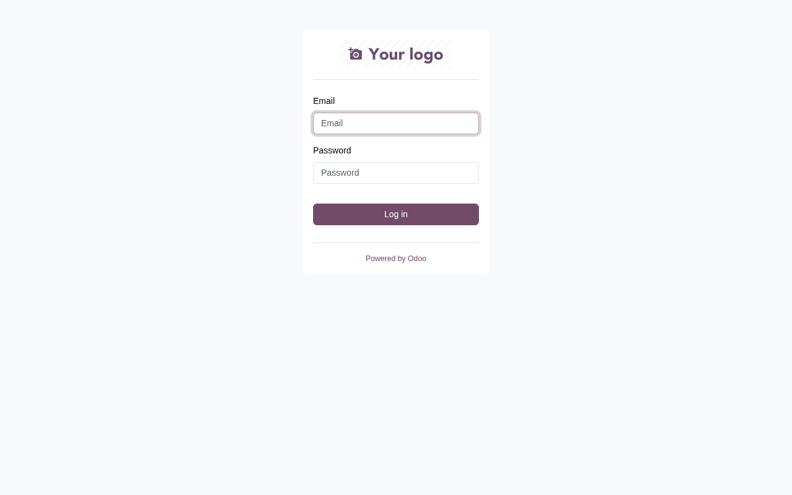
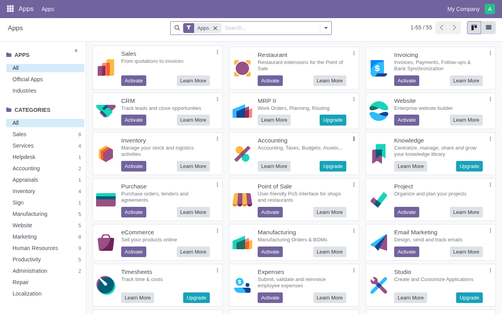
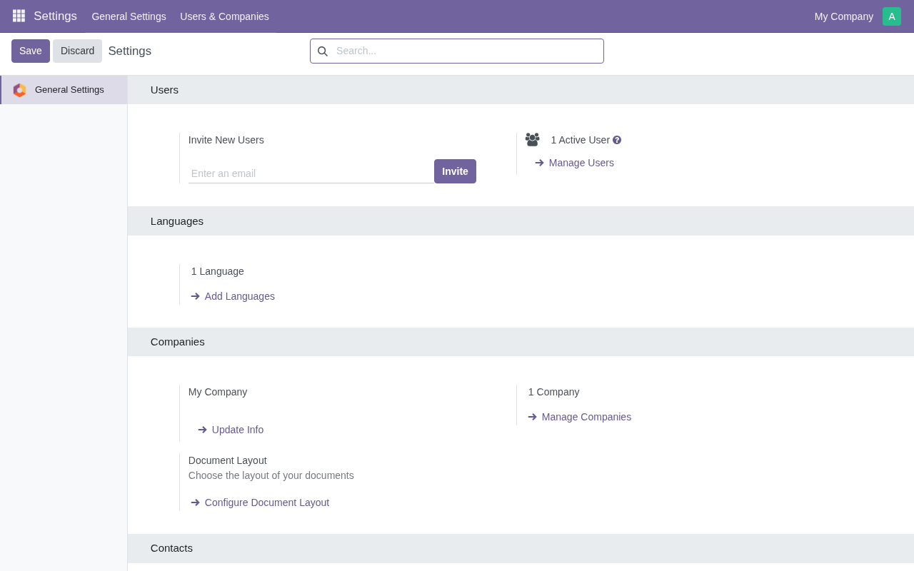
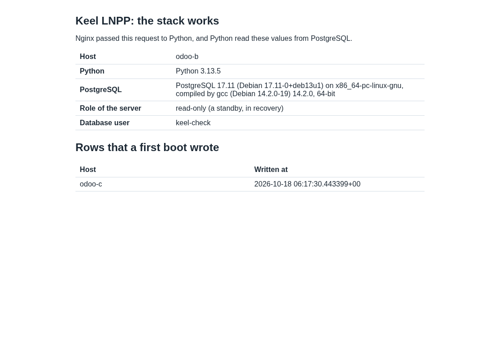
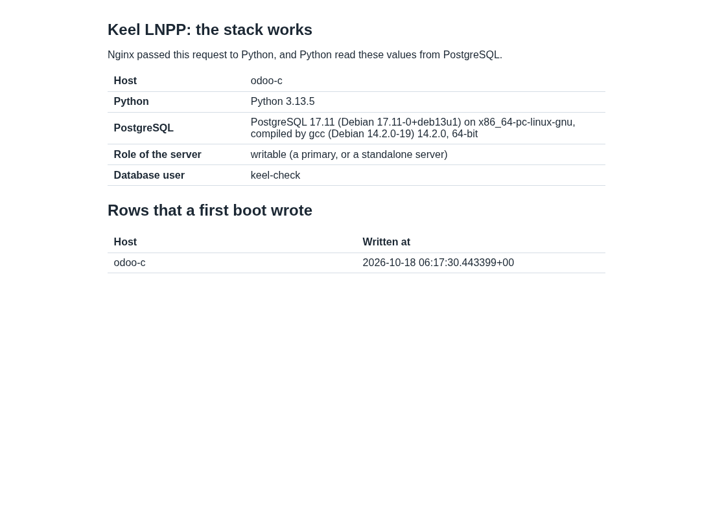

# Evidence: Odoo 18.0 on Nginx and LNPP (19.0-2), a release test across 2 sites

Date: 2026-10-18. The time zone is UTC.
Decisions: 0022, 0054, 0057, 0059, 0061. The maintainer asked for the
task on 2026-10-18: move the Odoo appliance from Apache to Nginx, on the
LNPP stack (decision 0059, step 6). Rule of the maintainer, 2026-10-16: a
release test uses 3 CTs, 2 on BR1 and 1 on BR2, with the database pair
across the 2 sites.

No secret is in this file. Output is trimmed. Test passwords are random.

## Result

| Image | sha512 (first 16) | keel | Result |
| --- | --- | --- | --- |
| `debian-13-keel-odoo_19.0-2_amd64.tar.zst` | `5c63a92a6b796a00` | 0.23.43 | PASS, every item. The open items are under "Open" |

| Item | Result for Odoo 19.0-2 |
| --- | --- |
| Odoo on the LNPP layer | The layer is built on `lnpp` (chain Core, Web, LNPP, Odoo). The image has no `apache2`, and `conf.d/zz-check` fails the build if it has one |
| First boot | 3 of 3 CTs complete the first boot headless from a spec; `systemd-modules-load` is the only failed unit; keel 0.23.43 on all; Odoo is active on each node after the first boot (the writable node) |
| Passwords | The admin user and the master password come from `secrets.app_password`. The image has no known password: the admin user has a NULL password after the build, and Odoo does not start before the hook finishes |
| Mesh and etcd | 3 voters healthy, 2 on BR1 and 1 on BR2 |
| Check page | `/keel-check/` answers 200 at the VIP, on B and on C (screenshots) |
| Odoo login at the VIP | Anubis, Coraza and Nginx in front. Headless Chromium logs in as `admin`, the web client loads, the Settings app and the Apps list answer with no response of 400 or more (screenshots). `load_menus` answers 200 |
| Writes replicate | a row written on the primary is on B at the first read, 7 s later; the attachment and every partner of the Odoo writer are on both nodes |
| Filestore | Attachments are in the database: 0 rows with `store_fname` and no `/var/lib/odoo/filestore` on both nodes. A 400000 byte file, uploaded at the VIP, has the same sha256 after the failover, read from the new primary |
| Failover 1, network cut of C | VIP lands on B 20.65 s after the cut; first write acknowledged 1.78 s after the VIP; 0 acknowledged writes on C after the cut; 0 of 1348 ids lost; Odoo answers a write 11.79 s after the VIP; 0 of 517 Odoo writes lost |
| Old primary fenced | C is in recovery, fenced in its VIP state, Odoo is stopped (502 on its login page), and C does not carry the VIP |
| Reseed | `--destroy-local-database` on C: seeded, streaming, synchronous; the VIP fence is cleared; Odoo stays stopped on C |
| Failover 2, `pct stop` of B | VIP lands on C 19.25 s after the stop; first write 2.21 s after the VIP; 0 of 946 ids lost; Odoo answers a write 16.97 s after the VIP; 0 of 456 Odoo writes lost |
| netem, cut of B | 250 ms ±25 ms, 1.5 % loss: VIP on C 23.69 s after the cut; first write 1.51 s after the VIP; 0 of 986 ids lost; Odoo answers a write 8.71 s after the VIP; 0 of 217 Odoo writes lost; reseed works (268 s) |
| netem, `pct stop` of C | VIP on B 18.76 s after the stop; first write 1.82 s after the VIP; 0 of 1125 ids lost; Odoo answers a write 15.07 s after the VIP; 0 of 464 Odoo writes lost; reseed works |
| A primary that took no write | **Not met, by design of 0054.** B, the holder, was cut for 87 s while no test writer ran. It came back read only and "diverged: timeline 6 against the holder's 7", and needed a reseed. The item belongs to the MariaDB pair (keel#202). See "A primary that took no write" and the question under "Open" |
| Firewall | the same input chain on all 3 CTs; 5432 answers on `wg0` and the VIP only; 8069 and 8072 are closed everywhere; see "Firewall" |
| End | `keel diff` shows no drift on W, B and C (33 same, 0 drift); no netem and no test nft table; every one of the 4534 acknowledged database ids and the 2099 acknowledged Odoo ids is on both nodes, and both nodes hold 4536 test rows and 2101 partners |
| Screenshots | the login page, the web client, the Settings app and the check pages |

The numbers of the DB writers and of the Odoo writer are two measures of
two different things: the first write that PostgreSQL acknowledges after
the VIP lands, and the first write that Odoo acknowledges through the VIP.
The second adds the start of Odoo on the new primary (see "Odoo follows
the writable PostgreSQL").

## What changed

Every pull request merged with every check green, merge commits only.

| PR | What |
| --- | --- |
| keel-odoo#4 | The layer on `lnpp`, with no Apache: Odoo 18.0 from a pinned snapshot, the Nginx route, peer authentication, attachments in the database, the first boot hook, the follow timer, the CRS exclusion and the tests. Changelog 19.0 (1) |
| keel-odoo#5 | The build asserts that no active user has a password. The first build of 19.0 (1) stopped there, so 19.0 (1) is not published. Changelog 19.0 (2) |
| keel-odoo#6 | The spec of the boot test names no appliance (found by the first gate run) |
| apt#50 | `odoo lnpp` in `conf/appliances`, and `keel-odoo` in `conf/image-ci`, so the image build per merge (decision 0061) boots the layer |
| `Keel-Linux/odoo` | A new repository: one commit that is the tree of `odoo/odoo` branch `18.0` at `1f2b50ade7a1`, with the tag `snapshot-18.0-1f2b50ade7a1` |
| common#58 | An issue: a WebSocket does not pass the Anubis front |

The tests were written first. `tests/python` covers the first boot hook
and the follow script at 100 percent of lines and branches. The kcov
coverage of `conf.d/zz-check` and of the boot test library is 100
percent. `tests/stack.bats` puts the real sites of keel-web, the route of
this layer and two stub servers on one machine, and proves that `nginx -t`
accepts them, that each route reaches its port, that the websocket headers
pass, and that Odoo sees `https` behind the socket of Anubis. The boot
test logs in as `admin` with the declared password and loads a script
bundle of the web client from the database.

A review by a second agent found 1 high and 3 medium problems before the
merge: a known password in the image database, a log level that hid
tracebacks, a first boot hook that would fail on a standby, and an
exclusion regular expression that accepted `..`. All 4 are fixed, with
tests, in keel-odoo#4.

## Design choices

### Odoo on the LNPP layer

Odoo 18.0 is a checkout of `Keel-Linux/odoo` in `/opt/odoo/18.0`. The
snapshot is one commit, so the repository is small and the build needs no
third party. The build stops if the commit is not the pinned one. The
Python libraries come from Debian 13 (the list of Odoo's own
`debian/control`). Odoo 18.0 runs on Python 3.13 with them. Nothing is
installed with pip. The Odoo 16 of bookworm-backports is gone. The build
removes the private keys that the upstream tree and `python3-ldap` hold as
test fixtures: `bt-layer` refuses a layer with a private key.

Nginx proxies HTTP to `127.0.0.1:8069` and `/websocket` to
`127.0.0.1:8072`, and Odoo runs with `proxy_mode` on. The route is a file
in the include directory of keel-web. It uses `location ~ ^/`, because
`location /` and `location ^~ /` are both a duplicate of the location of
keel-web (`nginx -t`: duplicate location "/"). A longer prefix
(`/keel-check/`) and an exact match (`/keel-health`) still win.

Odoo connects on the unix socket. PostgreSQL authenticates the operating
system user `odoo` by peer. There is no database password in the image or
on the disk. The role `odoo` has no `CREATEDB`, and `list_db` is off.

### The filestore survives a failover

The choice of least power is to store attachments in the database
(`ir_attachment.location` is `db`). The pair of decision 0054 then carries
them, with no mechanism beside it. The build sets the parameter and moves
the attachments of the installation with `force_storage()`. It asserts 0
rows with `store_fname`. The cost is a larger database and slower access
to large files. A database that an operator creates later needs the same
parameter. Sessions are files in `/var/lib/odoo/sessions`, so users log in
again after a failover.

Measured: 14 attachments on both nodes, 0 in files, 13 in the database
(one has no data). After round 1 the file of 400000 bytes, uploaded at the
VIP before the cut, was read at the VIP from the new primary with the same
sha256 (`e41b5987c23aadd9`), `store_fname` empty.

### Odoo follows the writable PostgreSQL

A standby refuses every write, and Odoo writes at start and in its cron
jobs. So `keel-odoo-follow.timer` runs `follow.py` every 3 seconds. It
starts Odoo when PostgreSQL accepts writes and stops it when PostgreSQL is
a standby. When the server does not answer, it changes nothing, so a
restart of PostgreSQL does not take Odoo down. Odoo does not start before
`/var/lib/keel-odoo/ready` exists, which the first boot hook writes at its
end.

The unit is not a process of the manifest: Monit would start it on a
standby. The follow script is its only supervisor. `keel diff` is clean on
the writable node and on the standby.

The cost is the start of Odoo after a failover: from 8.7 s to 17 s after
the VIP lands in these rounds (PostgreSQL takes about 2 s, the next tick
of the timer at most 3 s, and Odoo about 5 to 10 s).

### The Core Rule Set

In the cloud modes Coraza reads every request. Two findings:

- CRS 930130 ("Restricted File Access Attempt") found `.settings/` in
  `/web/dataset/call_kw/res.config.settings/get_views` and blocked the
  Settings app with 403. A CRS plugin
  (`/etc/coreruleset/plugins/keel-odoo-before.conf`, rule id 10100) ends
  that rule for the path of the Odoo routes only. The model in the path is
  a name of words joined by single dots, so it cannot name a file. Tests
  feed it `..`, `...` and `.git`.
- A JSON request of more than 128 KiB gets 403, the default limit of
  Coraza for a body with no file. The web client uploads files as
  `multipart/form-data`: 400000 bytes pass. A JSON-RPC call with a large
  base64 field does not.

### The websocket

On the unix socket of the app server, `/websocket` answers 101. Through
the front on 443 it answers 400: the snippet of `keel-overlay-anubis` sets
no `Upgrade` header. So the bus of Odoo (Discuss, notifications) does not
work in the cloud modes. common#58 has the cause and the fix. The simple
mode is not affected.

## Build and signatures

keel-odoo `master` at `f6755f1` was built on the build host with
`keel-release`, on Core (`b420d53`), Web 0.3.0 (`493438a`) and LNPP
19.0-5 (`f8b8640`). The layers of Core, Web and LNPP were not built again.
The image is signed by the main key and by the images key (decision 0055).

```
sha512sum -c debian-13-keel-odoo_19.0-2_amd64.tar.zst.sha512   OK
sqv --keyring keel-archive-keyring.asc   AD0964BE3F09DED469A3B6B2148E951314703180
sqv --keyring keel-images-keyring.asc    E71DB9C3CA6AC18075395CC3ED3A709C4F3E2F3C
```

Full digest:

```
5c63a92a6b796a006cd3368341e8b6bb403ad0b98bb08bc89d489b3ee6a5389ad79b670f0d91bd0082de61fe86565de2e411ad589d070b4c5e04485d292415bd  debian-13-keel-odoo_19.0-2_amd64.tar.zst
```

Size: 462,311,537 bytes. The Odoo layer is 181,267,137 bytes. The Forgejo
pre-release is `testing-19.0-2-20261018` on `Keel-Linux/keel-odoo`, with
the image, its `.sha512` and its `.sha512.asc`. The stable index is not
changed, and keel is in trixie-testing only. Build traps
that cost time:

- A layer whose tarball matches its manifest is not built again, also when
  the product has a new commit. After a fix, the old `odoo` layer files had
  to leave `/mnt/builds/layers` by hand.
- The first build failed on the snake oil certificate: the layers below
  remove it, and PostgreSQL does not start with it missing. The build now
  starts the cluster with TLS off, for that step alone.
- The first build also failed on the test keys (above).

## The test

BR1 is hw12-br1, BR2 is nfs1-br2. BR3-THIN is offline, so the test cuts
the CT of the holder and never the whole BR1 site (2 of the 3 voters are on
BR1).

| | BR1, witness | BR1, pair node | BR2, pair node |
| --- | --- | --- | --- |
| Odoo | 9145 `odoo-w` | 9146 `odoo-b`, replica at installation | 9147 `odoo-c`, primary at installation |

The method is the one of the LNPP 19.0-5 test. The test changes only the
network of a CT (an nft table, `tc netem` on the BR2 CT), the power of a CT
(`pct stop`, `pct start`), the test tools under `/root`, and a test
database with its writer account. Every product step is a keel command.

Two writers ran in each round. The database writers ran on both pair nodes:
one row every 0.1 s through the local socket, only while the node carries
the VIP. An id counts as acknowledged only when the client returned 0. The
Odoo writer ran on the witness: one `res.partner` every 0.5 s through the
VIP, with a login at the start and again after every error. Times are in
seconds after the fault.

### The failover rounds

| Round | Fault | Network | VIP left the old holder | VIP landed | First DB write after the VIP | Acks on the old holder after the fault | Acked ids missing on the survivor | First Odoo write after the VIP | Odoo writes missing | Old holder returns |
| --- | --- | --- | --- | --- | --- | --- | --- | --- | --- | --- |
| 1 | cut of C (the holder) | base | +12.70 | +20.65 | 1.78 s | 0 | 0 of 1348 | 11.79 s | 0 of 517 | read only, fenced, "diverged"; reseed |
| 2 | `pct stop` of B (the holder) | base | stopped | +19.25 | 2.21 s | 0 | 0 of 946 | 16.97 s | 0 of 456 | read only, "diverged"; reseed |
| 3 | cut of C (the holder) | netem | +12.55 | +20.54 | void | 0 | void | 18.61 s | 0 of 445 | read only, "diverged"; reseed |
| 4 | cut of B (the holder) | netem | +12.77 | +23.69 | 1.51 s | 0 | 0 of 986 | 8.71 s | 0 of 217 | read only, "diverged"; reseed (268 s) |
| 5 | `pct stop` of C (the holder) | netem | stopped | +18.76 | 1.82 s | 0 | 0 of 1125 | 15.07 s | 0 of 464 | read only, "diverged"; reseed |

Round 3 is void for the database writers. Their ids overlapped the ids of
round 2 (a harness slip: a new round needs new bases), so the new primary
answered `duplicate key` until the old ids ended, and the first write
counted 248 s. The Odoo numbers of round 3 are valid, because the Odoo
writer names its partners by round. Round 3 was run again as round 4, with
new ids. Rounds 2, 4 and 5 are the second failover in a row.

The overlay ping of the witness to C under netem: 230 / 257 / 278 ms
(min / avg / max), 0 of 30 lost, 3 etcd voters healthy. The Odoo database
is 25 MB. The reseed of an old holder took 268 s under netem and about 15 s
at base.

### A primary that took no write

The LNMP release test (keel#202) asks that an old primary that took no
write rejoins with no reseed. The PostgreSQL pair of decision 0054 never
does that: "the rejoin after a promotion is a confirmed reseed and nothing
else", because equal timelines do not prove that the copy is safe. The test
shows the measured behavior. The holder B was cut for 87 s with the test
writers stopped. The only writes on B were the cron jobs of Odoo.

```
no-write cut of B at 1792308150.6 ; the VIP landed on C at +25.4 s ; heal at +87.0 s
B after the heal: in recovery, Odoo stopped, fenced
  refused: diverged: this node holds transactions the holder lacks
  (timeline 6 against the holder's 7). It stays read only and is not
  connected; keel spec apply --system-only --destroy-local-database
  reseeds it from the holder, the dump above kept
```

So the item is a property of the design, not a defect of the layer. It
stays as it is, and the question is under "Open".

### Firewall

The input chain of `inet keel` is the same on W, B and C (policy drop):
tcp 22, 80, 443 and 12321, udp 51820, on `wg0` tcp 2379, 2380, 5432 and
51821, and the invite ports. Probes from W (a CT of BR1) and from the
workstation:

| From | To | Open | Closed |
| --- | --- | --- | --- |
| W | the VIP and the overlay addresses of B and C | 22, 80, 443, 12321, 5432; overlay also 51821, 2379, 2380 | 8069, 8072, 51820 (UDP), 8923, 9999 |
| W | public address of B | 22, 80, 443, 12321 | 5432, 8069, 8072, 51820, 51821, 2379, 2380 |
| workstation | public address of B | 22, 80, 443, 12321 | 5432, 8069, 8072, 51821, 2379, 2380 |
| W and workstation | public address of C | none (the upstream filter of BR2 passes no new connection) | all |

The database port is open on `wg0` and the VIP only. Odoo listens on the
loopback only, and no TCP port of Odoo is open to any address.

### Screenshots

Headless Chromium reads the pages through Anubis. It starts with
`--user-agent`, because Anubis denies the user agent of headless Chrome
(`bot/headless-chrome`) on the request of the service worker, and the deny
answer clears the Anubis cookie of the whole page. Each page was read.








## Open

- **The websocket does not pass Anubis (common#58).** In the cloud modes
  `/websocket` answers 400 through the front and 101 on the app socket. The
  bus of Odoo (Discuss, live notifications) does not work there. The web
  client, the Settings app and the Apps list work. The fix is in
  `keel-overlay-anubis`: a map and two `proxy_set_header` lines. It needs a
  new package in trixie-testing and a rebuild of the Web layer.
- **No `wkhtmltopdf`.** PDF reports do not render. Decision 0022 plans a
  pinned package in the Keel archive.
- **A JSON request of more than 128 KiB gets 403 in the cloud modes.** This
  is the default limit of Coraza for a body with no file. Uploads in
  `multipart/form-data`, which the web client uses for files, pass.
- **Odoo answers 8.7 s to 17 s after the VIP lands.** PostgreSQL accepts
  writes about 2 s after the VIP. Odoo needs the next tick of the timer and
  its own start. A warm standby would cut this time, but a standby refuses
  the writes of the cron jobs of Odoo, so it needs a design of its own.
- **The `appliance` gate of keel-odoo cannot boot the layer** until it is on
  the mirror (the same as keel-lnmp and keel-lnpp). The boot gate of
  decision 0061 is the image build per merge. Its first run (image-gate run
  18, on f6755f1) failed: `keel spec apply` on the host of the gate refused
  `appliance.name: odoo` in `tests/instance.yaml`, because the host has no
  `odoo.yaml` (keel-odoo#6 removes the section, as keel-lnpp has none). Its
  second run (image-gate run 19, build 20261018T125821Z, on bbc1346, with
  the pool refreshed from trixie-testing) booted all 9 appliances and
  passed. The Odoo boot test passed: the login page answers 200 with its
  form, the admin user logs in with the declared password, a script
  bundle of the web client is served (14857 bytes), the check page answers,
  and `keel diff` shows no drift. That image is a new build, so its bits
  differ from the bits of this test. The layer has the same content.
- **The first boot of PostgreSQL** (keel-postgresql#20, fixed in inithooks
  2.3.6+keel27 of trixie-testing) is not in this image: it carries the
  inithooks of LNPP 19.0-5. The first boot passed on 3 of 3 CTs. A new LNPP
  layer with the fix, and an Odoo layer on it, remove the risk.
- **keel-odoo had no branch protection**, and the image build per merge
  refuses a repository whose branch is not protected ("the branch master is
  not protected, so it is not built"). The branch has the rule of keel-lnpp
  now: the checks `tests / appliance`, `tests / package`, `tests /
  python`, `tests / stack`, `tests / tests` and `security / security` are
  required, and nobody pushes to it. This work merged only with all six
  green.
- The check page title says "Keel LNPP: the stack works" on an Odoo image:
  the page is the one of the lnpp layer.
- Test CTs left running: 9145 (BR1, witness), 9146 (BR1) and 9147 (BR2).
  The scratch CT 9144 was removed. The old LNPP CTs 9141 to 9143 were not
  touched.

Question for the maintainer, a yes or no: should keel rejoin an old
PostgreSQL primary that took no write without a reseed (a `pg_rewind` or a
timeline check), as the MariaDB pair does since keel 0.23.43?
