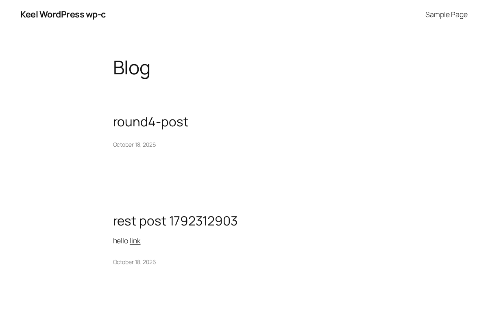
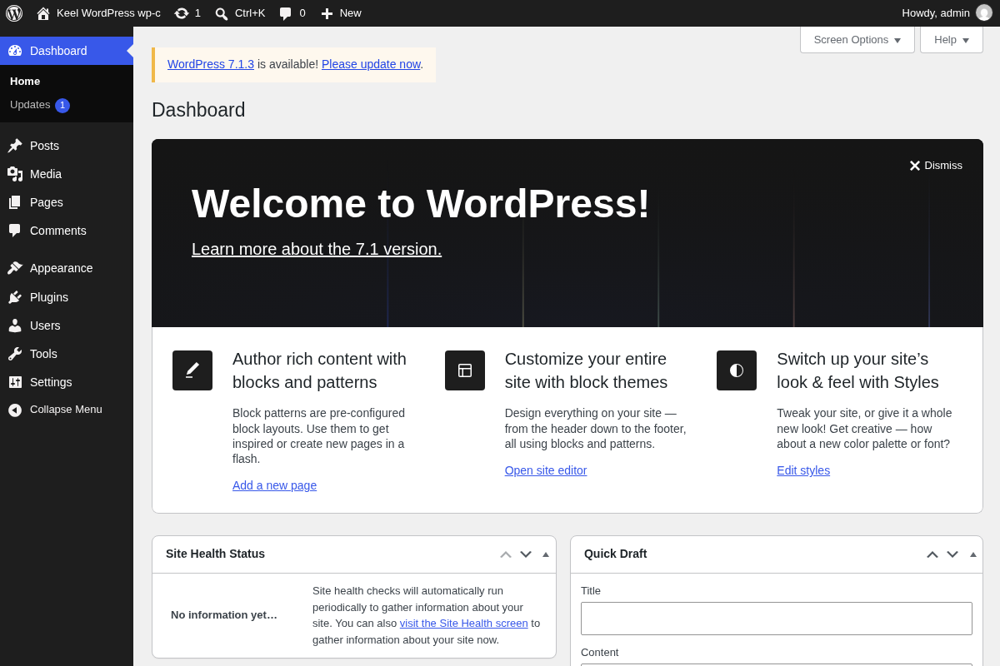
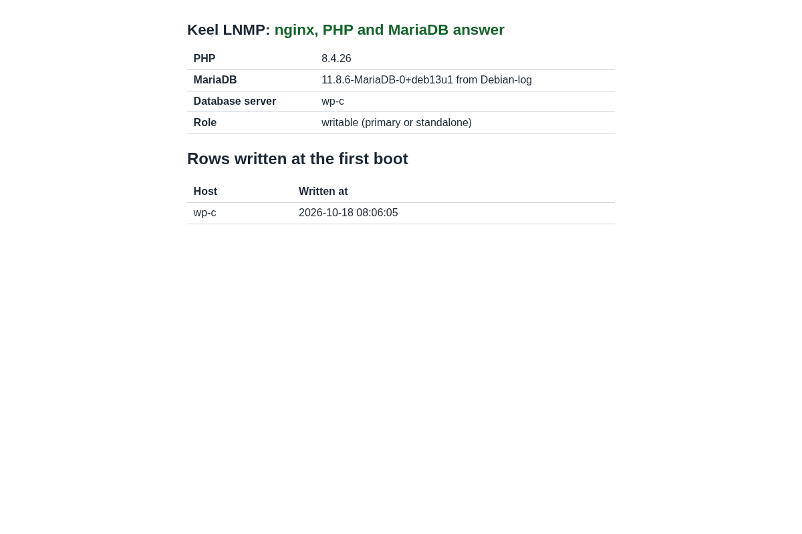
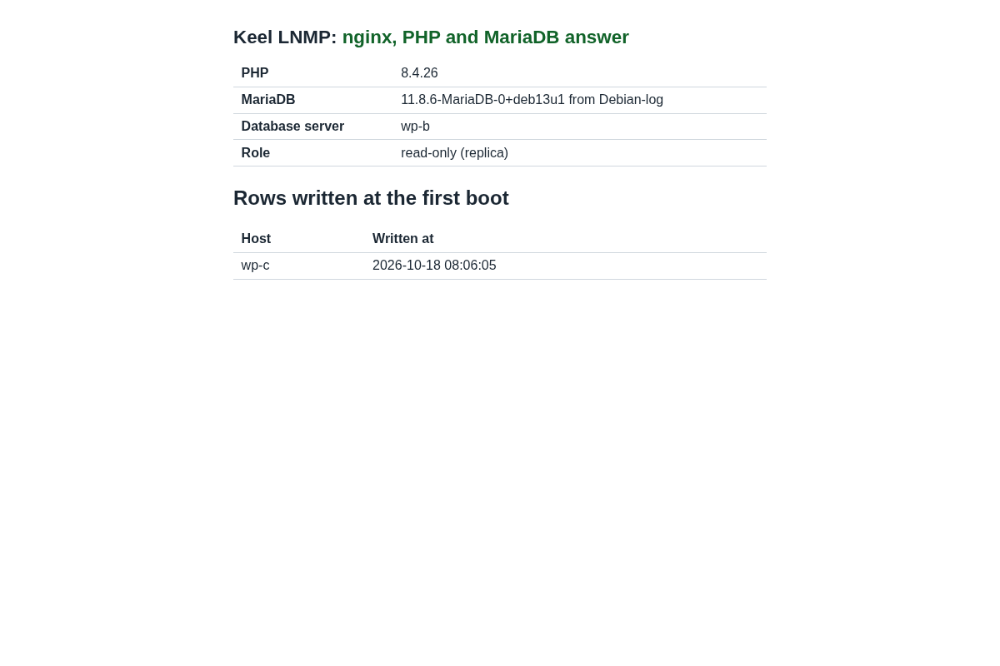

# Evidence: Keel WordPress 19.0-6 on nginx, and a release test across 2 sites

Date: 2026-10-18. The time zone is UTC.
Decisions: 0047, 0049, 0054, 0057, 0059, 0061. The maintainer asked for the
move on 2026-10-18 (decision 0059, step 4: WordPress on `lnmp`). Rule of the
maintainer, 2026-10-16: a release test uses 3 CTs, 2 on BR1 and 1 on BR2,
with the database pair across the 2 sites.

No secret is in this file. Output is trimmed. The passwords of the test are
random and are in no file of this repository.

## Result

| Image | sha512 (first 16) | keel | Result |
| --- | --- | --- | --- |
| `debian-13-keel-wordpress_19.0-6_amd64.tar.zst` | `c97e2b2302dad586` | 0.23.43 | PASS, every item of the list below |

This is the image of the build `20261018T074801Z` of the image build per
merge (decision 0061). It passed the image gate (run 16), it is the image of
this test, and it is the image of the pre-release: one file. The image has
no Apache package. The chain is Core 19.0-10, Web 19.0-6, LNMP 19.0-4 and
WordPress 19.0-6, at the commits keel-core `15f535f`, keel-web `6941c26`,
keel-lnmp `57c075c` and keel-wordpress `f692d90` (common `846894f`).
The test ran twice. The first candidate was a hand build of the layer on
the Core of 2026-10-16 (image `d6ff8ae12ba042a0`, not published). It passed
the same list, and it found the 2 defects in "Defects that the test found".
The second run, below, is on the image that the gate passed.

| Item | Result |
| --- | --- |
| First boot | 3 of 3 CTs complete the first boot headless; no failed unit; keel 0.23.43 on all |
| WordPress at the first boot | W and C install the site; B (spec role `replica`) writes `wp-config.php` and nothing in the database |
| Replica seed | `keel spec apply --system-only` on B seeds it from C with no `--destroy-local-database` (the image holds no WordPress schema) |
| Mesh and etcd | 3 voters healthy, 2 on BR1 and 1 on BR2 |
| Check page and site at the VIP | `/keel-check/` 200, `/` 200, `/hello-world/` 200 (pretty permalink), `/wp-json/` 200; all through Anubis and Coraza. `app.domain` is recorded as the site URL (`https://wp-vip.test`) and the VIP answers `/` with 200 and no redirect |
| Login | the right password: 302, the `wordpress_logged_in_` cookie, `/wp-admin/` 200; a wrong password: 200 and no cookie; a headless Chromium logs in through the Anubis challenge and shows the dashboard |
| Writes replicate | a post made on the holder is on the replica 3 s later; 16 posts on both nodes at the end |
| Block editor | a JSON `POST /wp-json/wp/v2/posts` with a block body answers 201 after every failover |
| Failover 1, network cut of C | VIP lands on B 19.4 s after the cut; first write 2.17 s after the VIP; 0 acknowledged writes on C after the cut; 0 of 2848 ids lost |
| Reseed | `--destroy-local-database` on C: 1 errant GTID discarded, seeded, streaming, semi-synchronous again, VIP fence cleared |
| Failover 2, `pct stop` of B | VIP lands on C 19.6 s after the stop; first write 1.24 s after the VIP; 0 of 2696 ids lost; B returns read only and replicates with no operator step |
| netem, cut of C | 250 ms ±25 ms, 1.5 % loss: VIP on B 21.3 s after the cut; first write 2.20 s after the VIP; 0 of 3155 ids lost; reseed works |
| netem, `pct stop` of B | VIP on C 21.3 s after the stop; first write 0.89 s after the VIP; 0 of 1886 ids lost |
| A cut in which the old primary took no write | C, the first primary, holds its first-boot GTIDs and the WordPress installation. After the cut and the heal it returns with "rejoined: no errant GTID" and needs no reseed |
| Firewall | the same input chain on all 3 CTs; 3306 answers on `wg0` only; see "Firewall" |
| `keel diff` | exit 0 on the 3 CTs, after every round |
| End | no netem, no test nft table; every one of 10585 acknowledged ids is on both nodes (10588 rows); the GTID state is the same on both nodes |
| Image | no `keel-pool.sources` and no `/keel-pool` in the image (the Core of the day leaves none) |
| Screenshots | the check page and the site at the VIP, the dashboard after a login, the check page of B and of C |

## What the move changed

keel-wordpress#22 (merge commit `b5f7438`) and apt#48 (`9060356`) moved
the recipe. Every check was green, and the merges used merge commits.

| What | Before | After |
| --- | --- | --- |
| Parent layer | `mariadb` | `lnmp` (nginx from Keel Web, PHP-FPM 8.4, MariaDB 11.8) |
| Web server | Apache, mod_php, mod_security2, mod_evasive | nginx and PHP-FPM; no Apache package |
| Site | `sites-available/wordpress.conf` | `/etc/nginx/keel-default.d/60-keel-wordpress.conf` |
| Manifest | none | `wordpress.yaml`, base `lnmp`; the spec names `appliance.name: wordpress` |
| Schema | made at the build | made at the first boot of a primary or a standalone node |
| Project packages | the staging archive of the build host | the Keel archive that Core configures, as in lnmp |
| wp-cron | a request to `http://[::1]/wp-cron.php` | `wp cron event run` as the web user |
| Panel ports | 22, 80, 443, 12320, 12321 | 22, 80, 443, 12321 (the web shell is not in Core) |

### The route

The default site of keel-web is a conffile. It has a `location /` and a
root of its own, and it includes `/etc/nginx/keel-default.d/*.conf` at
server level. A second `location /` is an error. If the layer edited the
file, `keel diff` would drift and the Anubis state hook would link the
file back. So the site is made of regular expressions. nginx takes the
longest prefix first, then the first regular expression that matches, and
a `^~` prefix or an exact location wins over both. Thus:

- `/keel-check/` is the `^~` prefix of lnmp, and no expression takes it;
- `/keel-health` and the two error pages are exact locations of the site;
- the refusals come first, then the PHP handler, then the catch-all
  `location ~ ^/`, which is `try_files` with a fallback to `index.php`.

The refusals: `wp-config*`; PHP in `uploads`, `cache`, `upgrade` and
`upgrade-temp-backup`; every PHP file of `wp-includes` and
`wp-admin/includes` except the TinyMCE compressor; hidden files except
`/.well-known/`; log, backup and dump files. `xmlrpc.php` stays
reachable. Nothing in Apache refused it, and the mobile apps use it.

The route answers 503 until the first boot hook writes a marker
(`/var/www/.keel-wordpress-ready`). nginx can be up before the first boot
ends, and without the marker the WordPress installer is open between the
write of `wp-config.php` and the end of the installation.

Probes at the VIP (HTTP status): `/wp-config.php` 403,
`/wp-content/uploads/x.php` 403, `/wp-includes/version.php` 403,
`/wp-includes/blocks/archives.php` 403, `/.git/config` 403,
`/xmlrpc.php` 405 (a GET; the server takes a POST).

### The replica

keel counts every schema that is not the server's own as a local
database, and refuses to replace it with the copy of the primary unless
`--destroy-local-database` is given. The old image held an empty
`wordpress` schema. So the first boot hook now asks the spec
(`database.server.role`) and `@@global.read_only`. On a replica it writes
`wp-config.php` and nothing in the database. On a primary or a standalone
node it makes the schema, grants the account, installs the site and sets
the permalinks to the post name. A spec that exists and cannot be read
stops the hook: it is not read as "no role".

## The test

BR1 is hw12-br1, BR2 is nfs1-br2. BR3-THIN is offline, so the test cuts
the CT of the primary and never the whole BR1 site.

| | BR1, witness | BR1, pair node | BR2, pair node |
| --- | --- | --- | --- |
| WordPress | 9134 `wp-w` | 9135 `wp-b`, replica at installation | 9136 `wp-c`, primary at installation |

All 3 nodes use `cloud_advanced` with Anubis and Coraza enabled, as the
LNMP test of 2026-10-17 did. The 2 pair nodes have one `db_password`. The
test changes only the network of a CT (an nft table, `tc netem` on the BR2
CT), the power of a CT (`pct stop`, `pct start`), the test tools under
`/root`, and a test database (`pairtest`) with its writer account. Every
product step is a keel command. The load average of hw12-br1 was 40 to 60
during the test (a language model server and the CI runner VM are on it),
and the times below include that.

### Failover rounds

Writers ran on both pair nodes: one through the local socket and one
through the VIP, each row every 0.1 s, only while the node carries the
VIP, killed after 45 s. An id counts as acknowledged only when the client
returned 0. Times are in seconds after the fault.

| Round | Fault | Network | VIP left the old holder | VIP landed | First write after the VIP | Acks on the old holder after the fault | Acked ids missing on the survivor | Old holder returns |
| --- | --- | --- | --- | --- | --- | --- | --- | --- |
| 1 | cut of C (the holder) | base | +11.6 | +19.4 | 2.17 s | 0 | 0 of 2848 | read only, "diverged" by 1 transaction, dump kept; reseed |
| 2 | `pct stop` of B (the holder) | base | stopped | +19.6 | 1.24 s | 0 | 0 of 2696 | read only, replicates by itself, no reseed needed |
| 3 | cut of C (the holder) | netem | +12.9 | +21.3 | 2.20 s | 0 | 0 of 3155 | read only, "diverged" by 1 transaction, dump kept; reseed |
| 4 | `pct stop` of B (the holder) | netem | stopped | +21.3 | 0.89 s | 0 | 0 of 1886 | read only, replicates by itself, no reseed needed |

Rounds 2 and 4 are the second failover in a row. In rounds 1 and 3 the
writes that waited on C when the cut came ended with an error 7.3 s and
7.8 s later at most (the fence ended their connections), and none was
acknowledged. The netem profile on the BR2 CT is `delay 250ms 25ms loss
1.5%`. Overlay ping from W to C: 233 / 253 / 277 ms (min / avg / max), 0 of
30 lost, 3 etcd voters healthy.

After each failover, at the new holder, and through Anubis and Coraza:
the login of the administrator, a post through the REST API with a JSON
body, and a post through wp-cli all worked (rounds 1 to 4 and the cut
with no write): 6 logins and 5 REST posts, all answered as they should.

### A cut in which the old primary took no write

C holds the GTIDs of its first boot and of the WordPress installation
(`0-869217910-93`), written before the pair formed. No writer ran. The
cut came at 1792311156.2.

```
VIP on B 24.5 s after the cut   (login, REST post and wp-cli post at the VIP: all worked)
heal at +87.2 s
C replicating 7.5 s after the heal
database.server.role: rejoined: no errant GTID, replicating from [...] over TLS from 0-1327582348-141
```

No reseed, no `--destroy-local-database`. A planned failback then worked:
`keel vip promote` on C asked B to release the VIP and C held it at epoch
3.

### Firewall

The input chain of `inet keel` is the same on W, B and C (policy drop; the
three digests of the rules are equal):

```
tcp 22, 80, 443, 12321; udp 51820
iifname wg0: tcp 2379, 2380, 3306, 51821
@mesh_invites
```

Probes (TCP):

| From | To | Open | Closed |
| --- | --- | --- | --- |
| W | the VIP, and the overlay addresses of B and C | 22, 80, 443, 3306, 12321; overlay also 2379, 2380, 51821 | 8923, 9999, 12320 |
| W | public address of B | 22, 80, 443, 12321 | 3306, 8923, 9999, 12320, 2379, 2380, 51821 |
| workstation | public addresses of W and B | 22, 80, 443, 12321 | 3306, 8923, 9999, 12320, 2379, 2380, 51821 |
| W and workstation | public address of C | 22 | all others (the upstream filter of BR2) |

The database port is open on `wg0` only.

### Screenshots

The pages are read through Anubis with a headless Chromium. A script maps
a name to a local port that reaches the node through the witness. The
dashboard shot is the result of a real login in the browser.







At the time of the shots C held the VIP: the page of C says "writable
(primary or standalone)" and the page of B says "read-only (replica)".

## Defects that the test found

The first candidate of the image (not published) failed in two places that
only the cloud modes show. Both are fixed in the published image, and the
second run confirms it.

1. **The login looped.** Behind Anubis a request reaches PHP-FPM from a
   unix socket, with `X-Forwarded-Proto: https` and no `HTTPS` variable.
   `wp-config.php` derived an https site URL from the header. WordPress
   then set `FORCE_SSL_ADMIN` from that URL, `is_ssl()` read only `HTTPS`,
   and `wp-login.php` redirected to itself for ever. Fix: `wp-config.php`
   sets `HTTPS` to `on` when the scheme it works out is https.
2. **The block editor could not save.** Coraza reads a JSON body as an
   urlencoded one: the JSON text is the name of one argument. The Core
   Rule Set read the HTML comments of the blocks as an attack (rule 941180,
   score 5) and answered 403. Fix: `/etc/coreruleset/plugins/keel-wordpress-before.conf`
   keeps the rules from reading the arguments of a JSON write to
   `/wp-json/`. The cause is in the Coraza overlay: Keel-Linux/common#59.

A review of the diff before the build found 7 more points. They are
fixed too: the 503 gate, the deny of every PHP file of `wp-includes`, the
grant for a schema with another name, the failure on an unreadable spec,
the copies of `wp-config`, a duplicated header, and a missing check of the
cron job.

## Limits that stay open

- **Uploads in the cloud modes.** The front site of Keel Web refuses a body
  of more than 1 MB with 413. With the limit raised at the http level, a
  3 MB body made one nginx worker grow to 1.4 GB and run at 50 percent CPU
  for more than 10 minutes, and the 2 GB container stopped answering. So
  the 1 MB limit is what protects the machine from Coraza. A media upload
  of more than 1 MB does not work behind Anubis and Coraza until the front
  site and the rules change: Keel-Linux/keel-web#15. In the simple mode
  nginx takes 64 MB, as PHP does.
- **The JSON exclusion** of defect 2 is to be removed when the overlay
  selects the JSON body processor (Keel-Linux/common#59).
- **The pool.** The build of the layer stopped at
  `keel-project-packages`: the pool `2026-10-08` held inithooks
  `2.3.6+keel26`, pinned at 1001, and trixie-testing had `2.3.6+keel27`
  since 03:50. The image build per merge failed in the same way for
  postgresql at 03:59. `inithooks_2.3.6+keel27_all.deb` was captured into
  the pool (add only: 596 members instead of 595).

## Build and gate

The image gate built it, and the gate passed it. The build `20261018T074801Z`
of the image build per merge (decision 0061) used `keel-release --staging
--match-source` on the build host. The runner booted it as built, and the
build host signed the same files with the main key and the images key and
promoted them to testing. The Forgejo pre-release
`testing-19.0-6-20261018` on Keel-Linux/keel-wordpress is that file, at
the commit `f692d90`. The stable index is not changed, and keel is not
changed (0.23.43, in trixie-testing since 2026-10-17).

```
sha512 c97e2b2302dad5860b2cb190b5634739dfc7daee9e1b2e2cb8877668cf473914db80de8b827a65b68c059cc32ac163fe9e2c4efef72722ac7a8d9a8d3475eba5  debian-13-keel-wordpress_19.0-6_amd64.tar.zst
sqv --keyring keel-archive-keyring.gpg   AD0964BE3F09DED469A3B6B2148E951314703180   (main key)
sqv --keyring keel-images-keyring.gpg    E71DB9C3CA6AC18075395CC3ED3A709C4F3E2F3C   (images key)
```

Size: 305,197,501 bytes. The `.sha512.asc` file holds one signature of each
key, and each key verifies it alone.

### The image gate

It took 4 runs of the gate to pass. Each failure was a defect of the boot
test of this repository, not of the image:

| Run | Result | Cause | Fix |
| --- | --- | --- | --- |
| 13 | failed in 90 s | `keel spec apply` on the runner: "wordpress is not an installed appliance under /usr/share/keel". The runner holds no manifest of the layer | keel-wordpress#23: `--root "$BT_ROOTFS"`, as in keel-lnmp |
| 14 | failed | every first boot hook and every proof of the site passed; the check of `keel.sources` wanted the `.asc` keyring, and Core of the day names the `.gpg` keyring and a testing key | keel-wordpress#24 |
| 15 | failed | `apt-get update could not fetch https://archive.keellinux.org`: the runner has no route to the archive (tracker#5) | keel-wordpress#25: the boot test keeps the file checks and drops the 4 proofs that ask the archive, as keel-lnmp has none |
| 16 | **passed** | build 20261018T074801Z, from `f692d90`: first boot, the check page, a pretty permalink, the REST API, the 3 refusals, the login and the dashboard, a wrong password refused, `keel diff` with no drift | |

The proofs of the gate on the image, from the job log of run 16:

```
boot-test: port 443 answered 200, title 'Keel WordPress boot test'
boot-test: port 80 answered 200, title 'Keel WordPress boot test'
boot-test: /keel-check/ answered 200
boot-test: /hello-world/ (pretty permalink) answered 200
boot-test: /wp-json/ (REST API) answered 200
boot-test: /wp-config.php answered 403
boot-test: /wp-content/uploads/x.php answered 403
boot-test: /wp-includes/version.php answered 403
boot-test: the login was accepted and set a wordpress_logged_in_ cookie
boot-test: /wp-admin/ answered 200 with the dashboard for the logged in admin
boot-test: wordpress boot test passed
```

The build host opened image-gate#14, #15 and #16 for the 3 failed runs of
this recipe, and they are closed with the cause. image-gate#13 (a build of
postgresql that failed at 03:59) has the same cause as the pool item above.

### Pull requests

| PR | What |
| --- | --- |
| keel-wordpress#22 | The move: nginx, the route, the manifest, the replica rule, the first boot, the examples, the tests |
| keel-wordpress#23, #24, #25 | The 3 fixes of the boot test above |
| apt#48 | The parent of `wordpress` is `lnmp`, and `wordpress` is in the CI set of the image build per merge |
| handbook#106 and this change | The evidence, and the note of decision 0059 |

Issues opened: Keel-Linux/common#59 (the JSON body processor of Coraza) and
Keel-Linux/keel-web#15 (the body limit of the front site).

### The test machines

CTs 9134, 9135 (BR1) and 9136 (BR2) stay running for the maintainer. The
CTs of the LNMP 19.0-4 test (9131, 9132 and 9133) were removed after the
first run passed.
